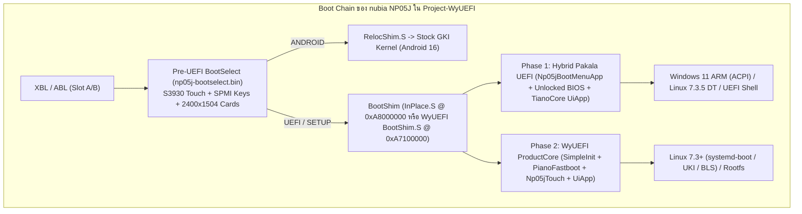
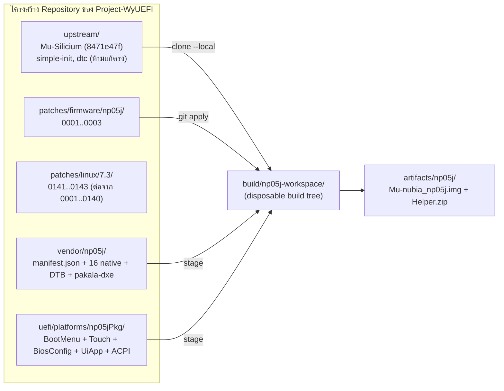

# คู่มือย้าย Porting `nubia_np05j` (REDMAGIC Astra) จาก `Mu-Silicium` ไปยัง `Project-WyUEFI`

> เอกสารฉบับนี้อธิบายสถาปัตยกรรม ความแตกต่างของฮาร์ดแวร์/ซอฟต์แวร์ โครงสร้างไฟล์ทั้งหมดในชุด Migration ZIP ขั้นตอนการประกอบ (Phase 1 & Phase 2) และวิธี Patch ครบทุกชั้น (Firmware/EDK2, Qualcomm Pakala DXE, Linux 7.3 Kernel, และ Android Boot Helper) เพื่อย้ายพอร์ต **`nubia_np05j`** (`SM8750P`) จากสาขา `np05j-port` ไปยัง [`Project-WyUEFI`](https://github.com/tanaiporserver/Project-WyUEFI/tree/main) โดยไม่แก้ไขไฟล์ใน `upstream/` โดยตรง

---

## 1. ภาพรวมและเปรียบเทียบสถาปัตยกรรม (`Mu-Silicium np05j-port` vs `Project-WyUEFI`)

`Project-WyUEFI` เป็น fork ของ [Project SunUEFI](https://github.com/slwyts/Project-SunUEFI) (EDK2 + Mainline Linux 7.3 + Android Boot Helper) ที่สร้างขึ้นมาสำหรับ **Xiaomi Pad 8 Pro (`piano`)** และมีต้นแบบ UEFI Touch สำหรับ **Lenovo Legion Y700 Gen 4 (`y700`)** โดยยึดหลัก **"Upstream Submodules Are Read-Only"** — โค้ดภายนอกถูกปักหมุดใน `upstream/` (เช่น `upstream/Mu-Silicium` ที่ commit `8471e47f5248ebbffc2e6196b683204163efe155`) แล้วสร้างสำเนาชั่วคราวใน `build/firmware-workspace/` เพื่อ apply patch และประกอบแพลตฟอร์มขณะบิลด์

### 1.1 ตารางเปรียบเทียบฮาร์ดแวร์และโครงสร้างเฟิร์มแวร์

| หัวข้อ | `nubia NP05J` (REDMAGIC Astra) | `Xiaomi Pad 8 Pro` (`piano` ใน WyUEFI) | `Lenovo Y700 Gen 4` (`y700Pkg` ใน WyUEFI) |
| :--- | :--- | :--- | :--- |
| **SoC / Platform** | Qualcomm **SM8750P** (`Pakala`, SoC 639 rev 2.0, 6×3.53GHz + 2×4.32GHz) | Qualcomm **SM8750P** (`Pakala`) | Qualcomm **SM8750** (`Pakala`) |
| **RAM** | **24 GiB** LPDDR5X (`0x80000000`–`0x0E00000000`, Micron) | 12 / 16 GiB LPDDR5X | 12 / 16 GiB LPDDR5X |
| **จอแสดงผล (GOP)** | **2400×1504** OLED (`0xFC800000`, `0x2B00000`, Himax HX8874) | **3200×2136** LCD (`0xFC800000`, `0x2B00000`) | 3040×1904 CSOT 3K |
| **UEFI Touch Controller** | **Synaptics `S3930TB0A0`** (TCM v2) over TLMM GPIO-SPI4 (`0xA90000`, GPIO `48..51`, RST `161`, IRQ `162`, `ldob4` 1.8V / `ldob14` 3.2V) | Novatek `NT36532E` over QUP1 SE2 SPI + GPI1 DMA | Novatek `NT36536` over GPIO-SPI (`0xA90000`, GPIO `48..51`, IRQ `162`) |
| **Keyboard / Cover** | ไม่มี Pogo Keyboard (`pogo_keyboard_touchpad: false`) | Official Nanosic Pogo Keyboard (QUP1 SE6 I²C) | ไม่มี |
| **Wi-Fi 7 & Bluetooth** | FastConnect 7900 / **WCN7861 "Peach"** (`17cb:110e`) + **BRAHMA 2.0** (`0x40210200` on `uart14` @ `3.2 Mbps`) | FastConnect 7900 / Peach (`17cb:110e`) + BRAHMA | — |
| **GPU** | Adreno 830v2 (`0x44050001`, `gen80000_*`) | Adreno 830 (`0x44050001`) | Adreno 830 |
| **ฮาร์ดแวร์เฉพาะรุ่น** | พัดลมระบายความร้อน `pwm-fan` (`pm8550_pwm` ch3 + tach GPIO 183), แอมป์คู่ NXP `TFA9874` (`0x34`/`0x35`), ไฟ RGB `AW22xxx` | Pen dock / P81C stylus, Dual battery MCA/BQ27Z561, กล้อง CAMSS | — |
| **UEFI FD Base / Size** | Phase 1: `0xA8010000` / `2 MiB` (`InPlace.S` @ `0xA8000000`)<br>Phase 2 target: `0xA7100000` / `3 MiB` | `0xA7100000` / `3 MiB` (`BootShim.S` relocate) | ใช้โครง `ProductCore` ร่วมกับ `piano` |
| **Boot UI / Console** | `Np05jBootMenuApp` (`SunUEFI Light` 6-row startup + 4 utility pills) + Unlocked BIOS Setup 9 หมวด + `TianoCore UiApp` + `Np05jGraphicsConsoleDxe` (ค่าเริ่มต้น `3x` = `800×501` / `80×25` สำหรับ `UiApp`, ปรับ `1x`–`3x` ได้) | `SimpleInit` + `TianoCore UiApp` + `PianoConsoleScale` (`4x` = `800×534`) | `SimpleInit` |
| **Android Combined BOOT** | `SPLITv1` / `NEXTv1` / `RSTRv1` (`np05j-boot-repack.c` + KSU WebUI EN/TH/ZH) | `SUNUEFI-SPLITv1` / `NEXTv1` / `RSTRv1` (`piano-boot-repack.c`) | — |
| **USB Fastboot / Debug** | `Np05jUsbSerialDxe` (Composite CDC-ACM `1209:0505` + SunUEFI Fastboot 0.4 `SunUEFI-np05j` + `Np05jLogRing` 256 KiB) | `PianoFastboot` (`SunUEFI-piano`) + RAM log | — |

### 1.2 แผนผัง Boot Chain และสถาปัตยกรรม Workspace





### 1.3 กลยุทธ์การย้าย 2 ระยะ (Dual-Phase Migration Strategy)

1. **Phase 1 — Hybrid Pakala-DXE Integration (พร้อมบิลด์และบูตบนเครื่องจริงได้ทันที)**:
   - ย้ายแพลตฟอร์ม `nubia_np05jPkg` (`4.1-SunUEFI-v5` รวมงานล่าสุดที่ยังไม่ commit ทั้งหมด + `sun.svg`), Pakala `.patched.efi` ทั้ง 8 ตัว, `BootSelect`, `AndroidHelper`, `Silicium-ACPI/Pakala + nubia_np05j`, และ Firmware/Linux Patches เข้าสู่โครงสร้าง `Project-WyUEFI` โดยบิลด์ผ่าน disposable workspace `build/np05j-workspace/` ด้วย `tools/build_np05j_hybrid.sh`
   - ได้ฟีเจอร์ครบทุกส่วนที่ผ่านการพอร์ตแล้ว: GOP `2400×1504`, Synaptics `S3930TB0A0` Touch (`Np05jTouchDxe`), UFS 4.0 RW, แรมเต็ม `24 GiB`, Composite USB CDC-ACM UART (`1209:0505`) + SunUEFI Fastboot 0.4 (`SunUEFI-np05j`), `Np05jBootMenuApp` + Unlocked BIOS Setup 9 หมวด + `TianoCore Setup (UiApp)`, Windows on ARM ACPI, Linux 7.3.5 DT, และ `NP05J-SunUEFI-Helper.zip`
2. **Phase 2 — Full SunUEFI `ProductCore` Unification (ผสานเข้าแกน `ProductCore` ของ WyUEFI)**:
   - เชื่อม `vendor/np05j/manifest.json` (`16` Foundation DXEs + `EnvDxeEnhanced` + `np05j.dtb` + `xbl-config.dtb`), `tools/np05j_vendor_inputs.py`, และ `tools/np05j_inherited_clock.py` เข้ากับ `prepare_product.py`
   - ปรับ `MemoryMapLib.c` ให้ตรงกับ carveout จริงของ NP05J, เชื่อม `Np05jTouchDxe` เข้าสู่ `PianoProductCore.c` ตามต้นแบบ `uefi/platforms/y700Pkg/Y700Touch.c`, รองรับสเกล `2400×1504` (`3x`) ใน `PianoConsoleScale.h` สำหรับ `UiApp`, และเชื่อมตัวแปร BIOS เข้ากับ `PianoNvFile` (`persist`) เพื่อให้ใช้ `SimpleInit`, `PianoFastboot`, `TianoCore UiApp`, และระบบ `sunuefi_esp`/`sunuefi_root` ร่วมกับ `piano` ได้ในโค้ดเบสเดียว

---

## 2. โครงสร้างไฟล์ทั้งหมดใน ZIP และการวางตำแหน่งใน `Project-WyUEFI`

ไฟล์ ZIP `Device_np05j/np05j-Project-WyUEFI-migration.zip` จัดวางโครงสร้างให้ตรงกับผังไดเรกทอรีของ `Project-WyUEFI`:

### 2.1 ตารางไฟล์ระดับบนของ ZIP

| โฟลเดอร์ / ไฟล์ใน ZIP | ปลายทางใน `Project-WyUEFI` | บทบาทและรายละเอียด | สถานะ |
| :--- | :--- | :--- | :--- |
| `MIGRATION_GUIDE.md` | อ้างอิงหลัก (หรือเก็บใน `docs/np05j/`) | คู่มือย้าย ประกอบ และ Patch ฉบับสมบูรณ์ | เอกสาร |
| `SHA256SUMS.txt` | ใช้ตรวจ integrity หลังแตกไฟล์ | เช็กซัม SHA-256 ของไฟล์ทุกไฟล์ใน ZIP | ตรวจรับ |
| `vendor/np05j/manifest.json` | `vendor/np05j/manifest.json` | บัญชีไฟล์ schema v1 ของ WyUEFI (`34` ไฟล์: 2 DTBs + 16×2 native) SHA-256: `39e36ce24f7ca1a98dc5b305c62f13e419bc29593d6407ed7dff6988a44ae70c` | ใหม่ |
| `vendor/np05j/dtb/np05j.dtb` | `vendor/np05j/dtb/np05j.dtb` | Board DTB ที่ล้าง `/chosen` snapshot properties แล้ว (SHA-256: `b7f6b40bd77ba6baa26bd209b53141882af85bab815cd182910007f43f1155c2`) | ใหม่ |
| `vendor/np05j/dtb/xbl-config.dtb` | `vendor/np05j/dtb/xbl-config.dtb` | XBL Config FDT จาก `xbl_config_b.img` offset `0x7fa4` (140,808 B) มี `/usb0/ss_phy_cfg` (SHA-256: `4587131d746da33c1c8da97728ab9318d5e671de742a73b0c312d8a021234621`) | ใหม่ |
| `vendor/np05j/early-dxe/EnvDxeEnhanced/*` | `vendor/np05j/early-dxe/EnvDxeEnhanced/` | `EnvDxeEnhanced.{efi,depex,inf}` + `provenance.json` | ใหม่ |
| `vendor/np05j/native/*` | `vendor/np05j/native/` | 16 Foundation DXEs (`.efi`/`.depex`) ใช้ชื่อตรง `NATIVE_NAMES` ของ WyUEFI | ใหม่ |
| `vendor/np05j/pakala-dxe/*` | `vendor/np05j/pakala-dxe/` | ชุด DXE Production ของ NP05J (`build_pakala_patches.py`, 8 `.patched.efi`, `RawFiles/`) ตัดไฟล์ debug เก่าออกแล้ว | ใหม่ |
| `uefi/platforms/np05jPkg/*` | `uefi/platforms/np05jPkg/` (และ stage เป็น `Platforms/ZTE/nubia_np05jPkg/`) | แพ็กเกจ UEFI สมบูรณ์ (รวม 21 ไฟล์ที่แก้ไขล่าสุด + `np05j.toml` + `native-modules.json`) | ใหม่ |
| `uefi/handoff/bootselect-np05j/*` | `uefi/handoff/bootselect-np05j/` | Pre-UEFI `BootSelect` (`Entry.S`, `RelocShim.S`, `EarlyTouch.c`, `EarlyKeys.c`, `EarlySplash.c`, `BootRequest.c/.h`) | ใหม่ |
| `uefi/handoff/bootshim-np05j/InPlace.S` | `uefi/handoff/bootshim-np05j/InPlace.S` | AArch64 In-Place BootShim (`PAYLOAD_OFFSET=0x10000`, `FD_BASE=0xA8010000`) | ใหม่ |
| `uefi/acpi/np05j/*` | Stage ลง `Silicium-ACPI/` | ตาราง ACPI สำหรับ `Pakala` (`APIC`, `FACP`, `GTDT`, `PPTT`) และ `nubia_np05j` (`DSDT`, `IORT`, `MCFG`, `SPCR`, `DBG2`) | ใหม่ |
| `patches/firmware/np05j/0001..0003` | `patches/firmware/np05j/` + merge เข้า `patches/firmware/series.json` | Git patches สำหรับ `upstream/Mu-Silicium` และ `Silicium-ACPI` (`series-np05j-fragment.json`) | Patch + Merge |
| `patches/linux/7.3/0141..0143` | `patches/linux/7.3/` + merge เข้า `patches/linux/7.3/series.json` | Kernel patches ที่ rebase ทับ `0001..0140` ของ WyUEFI แล้ว + โฟลเดอร์อ้างอิง `reference-standalone-7.3.5/` | Patch + Merge |
| `linux/dts/np05j/*` | `linux/dts/np05j/` | `sm8750-nubia-np05j-common.dtsi`, `.dts`, `-otg.dts`, `-gpu.dts` | ใหม่ |
| `linux/configs/np05j/*` | `linux/configs/np05j/` | Kernel config เต็ม (`7.3.5`) + fragments (`.frag`) + `prune_qcom_config.py` | ใหม่ |
| `linux/userspace/np05j/*` | `linux/userspace/np05j/` | `np05j-tool.c`, `np05j-fan`, `np05j-fw-load`, `np05j-status`, `np05j-touch-probe`, `init` | ใหม่ |
| `linux/scripts/np05j/*` & `linux/boot-scripts/np05j/*` | อ้างอิง / ESP scripts | `rebuild_kernel.sh`, `pack_logfs.sh`, `test_qemu.sh` และไฟล์ `.NSH` | ใหม่ |
| `android-np05j/*` | `android-np05j/` (หรือผสานเข้า `android/`) | KSU/SukiSU Module + WebUI (`sun.svg`, EN/TH/ZH) + `np05j-boot-repack.c` + `build_helper_module.py` | ใหม่ / Merge |
| `config/np05j-product.json` | `config/np05j-product.json` | Contract & feature map ของ NP05J ตามแบบ `piano-product.json` | ใหม่ |
| `tools/np05j_vendor_inputs.py` | `tools/np05j_vendor_inputs.py` | ตัวตรวจ integrity ของ `vendor/np05j/` | ใหม่ |
| `tools/np05j_inherited_clock.py` | `tools/np05j_inherited_clock.py` | ตัว patch `ClockDxe.efi` @ RVA `0xC270` เพื่อข้าม CESTA auto-init สำหรับ Phase 2 | ใหม่ |
| `tools/build_np05j_hybrid.sh` | `tools/build_np05j_hybrid.sh` | สคริปต์บิลด์ Phase 1 แบบ disposable workspace อัตโนมัติ | ใหม่ |
| `docs/np05j/*` | `docs/np05j/` | Runbook (`SKILL.md`), `dxe-patching-catalog.md`, และหลักฐานการพอร์ตบนเครื่องจริง (`.json`) | เอกสาร |

### 2.2 องค์ประกอบภายใน `uefi/platforms/np05jPkg/`

- **`Drivers/Np05jTouchDxe/` + `Include/Np05jSynapticsTcm2.h`**: ไดรเวอร์ Synaptics `S3930TB0A0` (TCM v2) GPIO-SPI4, RPMh `ldob4`/`ldob14`, `EFI_ABSOLUTE_POINTER_PROTOCOL`, `NP05J_TOUCH_INFO_PROTOCOL`, และ `ExitBootServices` restore (รายละเอียดเชิงลึกใน **บทที่ 5.3**)
- **`Drivers/Np05jGraphicsConsoleDxe/` (`Np05jConsoleScale.h`)**: ปรับ logical console scale (`1x`–`3x`, ค่าเริ่มต้น `3x` = `800×501` = `80×25` สำหรับ TianoCore `UiApp`) โดยคง physical GOP `2400×1504` สำหรับ Boot Menu และ OS
- **`Drivers/Np05jUsbSerialDxe/` + `Library/Np05jSerialPortLib/`**: Composite USB CDC-ACM virtual serial (`1209:0505`) + SunUEFI Fastboot 0.4 (`SunUEFI-np05j`: `Np05jFastbootCore.c`, `Np05jFastbootStorage.c`, `Np05jFastbootScreen.c`, `Include/Protocol/Np05jFastboot.h`) + `Np05jLogRing` 256 KiB
- **`Drivers/Np05jBiosConfigDxe/` + `Library/Np05jBiosConfigLib/` + `Include/Np05jBiosConfig.h`**: เก็บค่าตั้ง Unlocked BIOS 9 หมวดแบบ dual-copy CRC32 บน NVRAM (`L"Np05jBiosConfig"`) + FAT `\NP05J\bios-a.bin` / `bios-b.bin`
- **`Application/Np05jBootMenuApp/`**: SunUEFI Light Boot Menu 6 แถวหลัก (`ANDROID`, `WINDOWS 11 ARM`, `LINUX (DEVICETREE)`, `LINUX (ACPI)`, `BIOS SETUP (UNLOCKED)`, `TIANOCORE SETUP (UIAPP)`) + 4 utility pills (`UEFI SHELL`, `BOOT FILE (.EFI)`, `TOUCH TEST`, `POWER / RESET`), Unlocked BIOS Setup 9 หมวด (`Np05jBiosSetup.c`), ตัวเปิด `TianoCore UiApp` (`Np05jLaunchTianoSetup()` ใน `Np05jOsLauncher.c`), File Browser (`Np05jFileBrowser.c`), และ Touch Test 4 มุม (`Np05jTouchTest.c`)
- **`Library/Np05jSplashLib/`**: TianoCore vector splash + ปุ่มสัมผัส `[BOOT MENU]` / `[BIOS SETUP]` + BGRT
- **`Library/Np05jBootManagerLib/`**, **`Np05jResetLib/`** (Recovery/Bootloader/EDL 9008), **`Np05jRealTimeClockLib/`** (PMK8550 RTC), **`Np05jAcpiUpdateLib/`** (runtime DSDT/IORT/MCFG gating ตามค่า BIOS Config)
- **`Library/MemoryMapLib/` & `Library/ConfigurationMapLib/`**: แผนผังหน่วยความจำ 24 GiB และพารามิเตอร์ XBL slot B
- **`Tests/`**: Host unit tests (`test_touch_tcm2.c`, `test_bootselect.c`, `test_fastboot.c`, `test_boot_repack.py`)

> [!IMPORTANT]
> **กฎเหล็กของ `Project-WyUEFI` (`test_check_patch_series.py`)**:
> 1. **ห้ามแก้ไฟล์ใน `upstream/` โดยตรง** — ทุกการแก้ไขบน `Mu-Silicium` หรือ `Silicium-ACPI` ต้องผ่าน patch ใน `patches/firmware/` และ apply ใน `build/*-workspace/` เท่านั้น
> 2. **สคริปต์ `tools/build/check_patch_series.py` สแกนไฟล์ `*.patch` และ `series*.json` ทุกไฟล์ใต้ `patches/` แบบ recursive**:
>    - เมื่อคัดลอกเข้า `Project-WyUEFI/patches/` ให้คัดลอกเฉพาะ `0001..0003` (firmware) และ `0141..0143` (linux) แล้ว **merge** รายการเข้า `patches/firmware/series.json` และ `patches/linux/7.3/series.json`
>    - **ห้ามทิ้ง** `series-np05j-fragment.json`, `0003-silicium-acpi-pakala-and-np05j-sources-only.patch`, หรือ `reference-standalone-7.3.5/` ไว้ใต้ `Project-WyUEFI/patches/` มิฉะนั้น `./build.sh check` จะแจ้ง `patch is outside every series`

---

## 3. ขั้นตอนประกอบและบิลด์ (Assembly & Build Walkthrough)

### 3.1 เตรียมสภาพแวดล้อมและ Clone `Project-WyUEFI`

```bash
git clone https://github.com/tanaiporserver/Project-WyUEFI.git
cd Project-WyUEFI

# ดึง submodule ที่ถูกปักหมุดไว้ (upstream/Mu-Silicium, simple-init, dtc ฯลฯ)
./build.sh sources --group firmware
```

เลือกใช้สภาพแวดล้อมบิลด์อย่างใดอย่างหนึ่ง:
- **วิธี A (แนะนำ — Build Container ของ WyUEFI)**:
  ```bash
  python3 tools/build_container.py
  # จากนั้นรันคำสั่งบิลด์ภายใน container sunuefi-builder
  ```
- **วิธี B (Host Linux x86_64/ARM64 ที่มี Toolchain ครบ)**: ต้องมี `clang` (Clang 16+ พร้อม `lld-link`), `llvm-objcopy`, `iasl` (ACPICA), `nasm`, `dtc`, `aarch64-linux-gnu-gcc` (สำหรับ `BootSelect` และ `np05j-boot-repack`), `python3`, `make`, และ `edk2-pytool-extensions` / `requirements-build.txt` ใน `.venv`

### 3.2 แตก ZIP และตรวจสอบ Integrity

```bash
mkdir -p /tmp/np05j-migration
unzip /path/to/np05j-Project-WyUEFI-migration.zip -d /tmp/np05j-migration
cd /tmp/np05j-migration

# 1. ตรวจความถูกต้องของไฟล์ทั้งหมดใน ZIP
sha256sum -c SHA256SUMS.txt

# 2. ตรวจ vendor bundle (16 Native PE + DEPEX + Board DTB + XBL USB3 PHY DTB)
python3 tools/np05j_vendor_inputs.py
```

ผลลัพธ์ที่ต้องเห็น: `"status": "FIXED_VENDOR_INPUTS_VERIFIED_NOT_RUNTIME_AUTHORITY"`, `"native_drivers": 16`, `"files": 34`

### 3.3 ประกอบ Phase 1 (Hybrid Build — พร้อมใช้งานเต็มรูปแบบ)

คัดลอกไฟล์ส่วน Phase 1 เข้าสู่รากของ `Project-WyUEFI`:

```bash
WYUEFI=/path/to/Project-WyUEFI
MIG=/tmp/np05j-migration

# คัดลอก vendor, uefi, config, tools, android-np05j, docs
cp -a "$MIG/vendor/np05j"                  "$WYUEFI/vendor/"
mkdir -p "$WYUEFI/uefi/platforms" "$WYUEFI/uefi/handoff" "$WYUEFI/uefi/acpi"
cp -a "$MIG/uefi/platforms/np05jPkg"       "$WYUEFI/uefi/platforms/"
cp -a "$MIG/uefi/handoff/bootselect-np05j" "$WYUEFI/uefi/handoff/"
cp -a "$MIG/uefi/handoff/bootshim-np05j"   "$WYUEFI/uefi/handoff/"
cp -a "$MIG/uefi/acpi/np05j"               "$WYUEFI/uefi/acpi/"
cp -a "$MIG/config/np05j-product.json"     "$WYUEFI/config/"
cp -a "$MIG/tools/np05j_vendor_inputs.py" \
      "$MIG/tools/np05j_inherited_clock.py" \
      "$MIG/tools/build_np05j_hybrid.sh"   "$WYUEFI/tools/"
cp -a "$MIG/android-np05j"                 "$WYUEFI/"
cp -a "$MIG/docs/np05j"                    "$WYUEFI/docs/"

# คัดลอก Firmware patches (เฉพาะ 3 ไฟล์ที่จะลงทะเบียน)
mkdir -p "$WYUEFI/patches/firmware/np05j"
cp -a "$MIG/patches/firmware/np05j/0001-mu-silicium-64bit-clockdxe-smbios-bootoptions.patch" "$WYUEFI/patches/firmware/np05j/"
cp -a "$MIG/patches/firmware/np05j/0002-mu-silicium-bootshim-inplace-and-ramdisk.patch"        "$WYUEFI/patches/firmware/np05j/"
cp -a "$MIG/patches/firmware/np05j/0003-silicium-acpi-pakala-and-np05j.patch"                  "$WYUEFI/patches/firmware/np05j/"
```

จากนั้นสั่งบิลด์ Phase 1 แบบ Disposable Workspace:

```bash
cd "$WYUEFI"
# สร้าง .patched.efi ทั้ง 8 ตัวจาก stock slot B (ทดสอบได้ทันที)
python3 vendor/np05j/pakala-dxe/build_pakala_patches.py

# บิลด์ UEFI (DEBUG / RELEASE / ALL) + BootSelect + NP05J-SunUEFI-Helper.zip
bash tools/build_np05j_hybrid.sh ALL
```

**สิ่งที่ `build_np05j_hybrid.sh` ทำให้ทีละขั้น**:
1. `git clone --local` ตัว `upstream/Mu-Silicium` และ submodule ภายใน (`Mu_Basecore`, `Common/Mu`, `Common/Mu_OEM_Sample`, `Binaries`, `Silicium-ACPI`, `openssl`) ไปยัง `build/np05j-workspace/Mu-Silicium` โดยไม่แตะ `upstream/`
2. Apply `0001`, `0002` บน `Mu-Silicium`, `0003` บน `Silicium-ACPI`, และ `Resources/MuPatches/*.patch` บน `Mu_Basecore`
3. Stage `uefi/platforms/np05jPkg` → `Platforms/ZTE/nubia_np05jPkg`, `vendor/np05j/pakala-dxe` → `Binaries/nubia_np05j`, `vendor/np05j/dtb/np05j.dtb` → `Resources/DTBs/nubia_np05j.dtb`, `np05j.toml` → `Resources/Configs/nubia_np05j.toml` แล้วรัน `build_pakala_patches.py`
4. คอมไพล์ `BaseTools` + `python3 build_uefi.py -d nubia_np05j -r DEBUG|RELEASE`
5. คอมไพล์ Pre-UEFI `BootSelect` (`np05j-bootselect.bin`, `np05j-reloc-shim.bin`, `selector.json`)
6. คอมไพล์ static ARM64 `np05j-boot-repack` และแพ็ก `NP05J-SunUEFI-Helper.zip`
7. ส่งออกผลลัพธ์ทั้งหมดไปที่ `artifacts/np05j/`

### 3.4 ประกอบ Phase 2 (Full `ProductCore` Unification — ผสานเข้าแกน `PianoProductCore`)

เมื่อต้องการให้ NP05J ใช้ `PianoProductCore` + `SimpleInit` + `PianoFastboot` + `PianoNvFile` แบบเดียวกับ `piano` และ `y700Pkg` ให้ดำเนินการตามลำดับ Step A–G:

- **Step A — Vendor Inputs**: คัดลอก `tools/np05j_vendor_inputs.py` และ `vendor/np05j/` (16 Foundation DXEs + `EnvDxeEnhanced` + `np05j.dtb` + `xbl-config.dtb` ที่มี `/usb0/ss_phy_cfg/table` สำหรับจูน USB3 QMP PHY `0x88e8000`–`0x88eb000` ใน `PianoUsbPhyConfig.h`)
- **Step B — `ClockDxe` Inherited Clock Patch**:
  แทนที่ `piano_inherited_clock.py` ด้วย `tools/np05j_inherited_clock.py` เมื่อ target เป็น `np05j` (จะ patch `ClockDxe.efi` ที่ RVA `0xC270` ให้ข้าม CESTA media/display startup แต่ยังเปิด clock API สำหรับ UFS/USB ไว้)
- **Step C — `MemoryMapLib.c` & Carveout Differences (จุดระวังสูงสุด!)**:
  อย่าคัดลอก `fix_product_low_heap()` ของ `piano` มาใช้ตรงๆ โดยไม่แก้ตัวเลข! เปรียบเทียบจาก `Resources/DTBs/nubia_np05j.dtb` และ `uefi/platforms/np05jPkg/Library/MemoryMapLib/MemoryMapLib.c`:

  | Region | ตำแหน่งบน `piano` | ตำแหน่งจริงบน `nubia_np05j` |
  | :--- | :--- | :--- |
  | `adspslpi_region@9ee00000` | `0xB8200000` .. `0xBD980000` (ทับหัว `DXE_Heap`) | **`0x9EE00000` .. `0xA2880000`** (`size 0x3A80000`, ไม่ทับ `DXE_Heap`) |
  | `hwfence-shmem` | `0xD4E23000` .. `0xD5100000` (`0x2DD000`) | **`0xD4E23000` .. `0xD5100000`** (`0x2DD000`, ตรงกันและแยกไว้ใน `MemoryMapLib.c` แล้ว) |
  | `ramoops` | `0xA3500000` (`0x400000` ตัดจาก `Display_Demura`) | **`0xE4A00000` .. `0xE4C00000`** (`0x200000`, `RamConsole`) |
  | `DXE_Heap` | `0xBD930000` (`0x1A6D0000`) | **`0xB90C0000`** (`0x1BD63000`) |
  | `UEFI_FD` (ProductCore) | `0xA7100000` (`0x300000`) | ปรับใช้ `0xA7100000` (`0x300000`) กับ `BootShim.S` หรือคง `0xA8010000` (`0x200000`) กับ `InPlace.S` |
  | `Display_Reserved` | `0xFC800000` (`0x2B00000`) | `0xFC800000` (`0x2B00000`, ตรงกัน!) |

- **Step D — ผสาน Synaptics `S3930TB0A0` Touch เข้า `PianoProductCore.c`**:
  ใช้แบบแผนเดียวกับ `uefi/platforms/y700Pkg/Y700Touch.c` (ดู `docs/devel/hardware/y700-touch.md` ใน WyUEFI และพิมพ์เขียวฉบับเต็มใน **บทที่ 5.3**):
  - NP05J ใช้คอนโทรลเลอร์ SPI4 ตัวเดียวกับ Y700 (`0xA90000`, GPIO `48/49/50/51`, RST `161`, IRQ `162`) แต่เป็น IC **Synaptics S3930TB0A0 (TCM v2)** ที่ต้อง vote รางไฟ RPMh `ldob4` (`1800 mV`) และ `ldob14` (`3200 mV`) ก่อนปลด Reset และไม่ใช้ GENI GPI DMA (`AbsentOwnerMask |= PIANO_OWNER_GPI`)
  - สร้างอะแดปเตอร์ `Np05jTouchStart(Fdt)`, `Np05jTouchPump()`, `Np05jTouchReplay()`, `Np05jTouchStop(Context, Report)` ครอบลอจิกใน `uefi/platforms/np05jPkg/Drivers/Np05jTouchDxe/Np05jTouchDxe.c` + `Include/Np05jSynapticsTcm2.h` ภายใต้ flag `-DSUNUEFI_NP05J=1` แทน `PianoTouchStart` ใน `PianoProductCore.c`
- **Step E — Display Scaling (`UiApp` & Console) & Keyboard Config**:
  - `uefi/components/product-support/Library/ConsoleScale/PianoConsoleScale.h` ของ WyUEFI hardcode เฉพาะจอ `3200×2136` (`Scale = 4` → `800×534`); สำหรับจอ NP05J (`2400×1504`) ต้องปรับให้ใช้ Logical Console Scaling ค่าเริ่มต้น **`3x`** (`800×501` = `80×25` เต็มจอสำหรับ TianoCore `UiApp` และ UEFI Shell, ปรับ `1x`/`2x`/`3x` ได้ตาม `Np05jConsoleScale.h` — ดูรายละเอียดใน **บทที่ 5.2**)
  - ปิด `PianoPogoStart` (`pogo_keyboard_touchpad: false` ใน `config/np05j-product.json`) และผูก NVRAM ของ Unlocked BIOS Setup เข้ากับ `PianoNvFile` (**บทที่ 5.1**) เมื่อคอมไพล์ด้วย `-DSUNUEFI_NP05J=1`
- **Step F — BootSelect & Android Helper Unification**:
  - หากต้องการใช้ `android/` ของ WyUEFI ร่วมกับ NP05J ให้นำ `EarlyTouch.c` และขนาดจอ `2400×1504` จาก `uefi/handoff/bootselect-np05j/` ไปใส่ใน `uefi/handoff/bootselect/` (ภายใต้ `#ifdef SUNUEFI_NP05J`) และขยายตารางตรวจ device (`getprop ro.product.device` / `ro.boot.slot_suffix`) ใน `android/native/piano-boot-repack.c` หรือใช้ `android-np05j/` ร่วมกับ Boot Helper โดยตรง
- **Step G — Register Target ใน Build Scripts ของ WyUEFI**:
  - เพิ่ม `--device piano|np05j` ใน `tools/build_product.sh`, `tools/prepare_product.py`, `tools/build_stage0.sh`, `tools/package_product.py`, และ `build.sh`

---

## 4. คู่มือ Patch อย่างละเอียดครบทุกชั้น (Comprehensive Patching Manual)

### 4.1 Firmware / EDK2 / Mu-Silicium Patches (`patches/firmware/np05j/`)

| ลำดับ | ไฟล์ Patch | เป้าหมาย (`Repository` & `Base Commit`) | ไฟล์ที่ถูกแก้ไข / เพิ่ม และรายละเอียด |
| :---: | :--- | :--- | :--- |
| `0001` | `0001-mu-silicium-64bit-clockdxe-smbios-bootoptions.patch`<br>SHA-256: `7c5ef33329417df09a0d9ce38de745afecaad57fc44d5f5b26c9988739ea2c1d` | `upstream/Mu-Silicium`<br>(`8471e47f...`) | 1. `Silicon/Qualcomm/QcomPkg/Include/Protocol/EFIClock.h`: เพิ่ม `EFI_CLOCK_PROTOCOL_VERSION_64BIT` (`0x1000B`) และเมธอด 64-bit (`GetCpuPerfLevelFrequency64`, `SetCPUFrequency64`, `GetCPUFrequency64`)<br>2. `Silicon/Qualcomm/QcomPkg/Library/SmBiosTableLib/Utils.c`: รองรับ 64-bit ClockDxe + fallback `MaxPerfLevel - 1` สำหรับ Pakala<br>3. `Silicon/Silicium/SiliciumPkg/Drivers/SmBiosTableDxe/TableDefinitions.h`: แก้ SMBIOS Type 4 `.Status` เป็น `BIT6 \| BIT0` (`0x41`: Populated & Enabled)<br>4. `Silicon/Silicium/SiliciumPkg/Library/MsBootOptionsLib/MsBootOptionsLib.c`: แก้ format string `%a` → `%g` เมื่อพิมพ์ `EFI_GUID` |
| `0002` | `0002-mu-silicium-bootshim-inplace-and-ramdisk.patch`<br>SHA-256: `5034f7b37cac2404784982ff19a3cb6f07ae8d203b1cf1a12afd88703aba1ff8` | `upstream/Mu-Silicium`<br>(`8471e47f...`) | 1. เพิ่ม `BootShim/InPlace.S` (`PAYLOAD_OFFSET=0x10000`, ตรวจ `_Payload == FD_BASE` @ `0xA8010000`)<br>2. อัปเดต `BootShim/Makefile` รองรับ `IN_PLACE=1`<br>3. อัปเดต `build_uefi.py` รองรับ `[boot_shim].in_place` และ `[boot_image].include_ramdisk = false` |
| `0003` | `0003-silicium-acpi-pakala-and-np05j.patch`<br>SHA-256: `82e006395a2b198f308717f623d3a20610906da3b5d64b05453d8fa7ab0a6858` | `upstream/Mu-Silicium/Silicium-ACPI`<br>(`f50bc115...`) | เพิ่ม `Silicon/Qualcomm/Pakala/{APIC,FACP,GTDT,PPTT}.{dsl,aml}` (GICR stride `0x40000` ที่ `0x16080000..0x16240000`) และ `Platforms/ZTE/nubia_np05j/{AcpiTables.inf,DSDT,IORT,MCFG,SPCR,DBG2}` (มี `.patch` แบบ source-only แยกไว้ใน ZIP สำหรับรีวิว) |

> **หมายเหตุเรื่อง `Mu_Basecore`**: ไม่ต้องสร้าง patch สำหรับ `Mu_Basecore` เพิ่ม! เพราะ diff ทั้งหมดใน `Mu_Basecore` ของ workspace เดิม (`ArmGenericTimerPhyCounterLib`, `ArmGenericTimerVirtCounterLib`, `BootManagerMenuApp`, `UsbBusDxe`, `AuthVariableLib`) ตรงกับ `Resources/MuPatches/{Auth-Service,Boot-Manager,Timer,Usb-Bus}.patch` ทุกบรรทัด และ `Project-WyUEFI` apply ให้อยู่แล้วใน `tools/build_stage0.sh`

**วิธี Merge `series-np05j-fragment.json` เข้า `patches/firmware/series.json`** (เมื่อรวมเข้า flow หลักของ WyUEFI):
```bash
python3 - <<'PY'
import json, pathlib
wyuefi = pathlib.Path("/path/to/Project-WyUEFI")
mig = pathlib.Path("/tmp/np05j-migration")
s_file = wyuefi / "patches/firmware/series.json"
frag = json.loads((mig / "patches/firmware/np05j/series-np05j-fragment.json").read_text())
series = json.loads(s_file.read_text())
existing = {row["patch"] for row in series["patches"]}
for row in frag["patches"]:
    if row["patch"] not in existing:
        series["patches"].append(row)
s_file.write_text(json.dumps(series, indent=2) + "\n")
PY
```
จากนั้นตรวจด้วย `./build.sh check --pattern test_check_patch_series.py`

### 4.2 Qualcomm Pakala Binary DXE Patches (AArch64 PAC/BTI-Safe)

> [!CAUTION]
> ไบนารี DXE ของ SM8750 ถูกคอมไพล์ด้วย `CLANG16+` ที่เปิด **PAC (`PACIASP`/`AUTIASP`)** และ **BTI**: ห้ามเขียนทับ `PACIASP` โดยไม่แก้คำสั่ง `RET` คู่กัน และ **ต้องคำนวณ PE32+ Optional Header `CheckSum` ใหม่ทุกครั้ง** ด้วย `build_pakala_patches.py` หรือ `np05j_inherited_clock.py`

#### ชุด Phase 1: 8 Pakala DXE Patches (`vendor/np05j/pakala-dxe/build_pakala_patches.py`)

| ไดรเวอร์ (Stock SHA-256 Prefix) | Offset | Bytes เดิม → Bytes ใหม่ (ARM64) | เหตุผลทางเทคนิค |
| :--- | :--- | :--- | :--- |
| **`SPMIDxe.efi`**<br>(`b54536c0a1f22988...`) | `0x02DA8` | `fd7bbda9 f65701a9` → `mov w0, wzr; ret` (`e0031f2a c0035fd6`) | ข้ามการ re-init SPMI PIC หลัง `abl` ส่งมอบสิทธิ์ (ต้องคู่กับ `PmicDxeLa`) |
| **`PmicDxeLa.efi`**<br>(`bcdf689c0c6b4e52...`) | `0x04138`<br>`0x04140`<br>`0x13294`<br>`0x1E148` | `753d0094` → `nop` (`1f2003d5`)<br>`ce370094` → `nop` (`1f2003d5`)<br>`fd7bbea9 f30b00f9` → `mov w0, wzr; ret`<br>`20adff97` → `mov w0, wzr` | ข้ามการ init/disable PMIC peripheral ซ้ำบน channel ที่ถูกล็อกโดย TZ/XBL เพื่อกัน Synchronous External Abort |
| **`UFSDxe.efi`**<br>(`20f961dff1ac34c1...`) | `0x0A998`<br>`0x1191C`<br>`0x1FF00` | `83050094 80fdff35` → `mov w1, #1; bl 0xC0D0`<br>`5afeff97` → `b 0x1FF00`<br>`.text` cave trampoline ล้าง `[x0, #0x4A1]` + `bl 0x106D0` + `bl 0x11284` | บังคับปลุก UFS link กลับมา Active และตรวจสอบ gear ให้ `BlkIo` อ่าน/เขียน UFS 4.0 ได้ที่ EL1 |
| **`TzDxeLA.efi`**<br>(`cff4cdcb726a42df...`) | `0x0F5B0` | `0x00` → `0x01` | ตั้งค่า global TZ Applet initialized flag เป็น `TRUE` ป้องกันการโหลด Applet ซ้ำที่ EL1 |
| **`QcomChargerDxeLA.efi`**<br>(`9449a16e9197714c...`) | `0x09BC8`<br>`0x09BEC`<br>`0x09C10`<br>`0x0C2B8` | `00013fd6` (`blr x8`) ×3 → `mov x0, xzr` (`e0031faa`)<br>`fd7bbea9 f44f01a9` → `mov x0, xzr; ret` | ข้ามการเรียก charger protocol ที่ทำให้ค้าง/crash ในสภาพแวดล้อม EL1 |
| **`UsbConfigDxe.efi`**<br>(`dc7e3cda7ae7a9ce...`) | `0x04948`<br>`0x0495C`<br>`0x04A54`<br>`0x04BB0`<br>`0x0E456` | `1f511e39` → `nop`<br>`1f090071` (`cmp w8, #2`) → `7f0a0071` (`cmp w21, #2`)<br>`d6000037` → `nop`<br>`28010034` → `b 0x4BD4`<br>`0x00` → `0x01` (`StartControllerOnAttach`) | เปิด Type-C Dual-Role 100ms polling (`HandlePortPartnerXtach`) และข้าม USB deinit ใน `ExitBootServices` |
| **`UsbPwrCtrlDxe.efi`**<br>(`e8be9562d8008b8c...`) | `0x0819C` | `0x02` (PMIC) → `0x06` (Fixed SDP) | ป้องกัน crash จาก PMIC charger port detection เมื่อเริ่ม USB Device Mode |
| **`ButtonsDxe.efi`**<br>(`910ce8adb1d85012...`) | `0x036B8` | `48208052 d6ffff17` → `mov w8, #0xD; b 0x3670` | Map ปุ่ม Power (`0x102`) เป็น `CHAR_CARRIAGE_RETURN` (`0x000D` Enter) |

#### ชุด Phase 2: `ClockDxe.efi` Inherited Clock Patch (`tools/np05j_inherited_clock.py`)

เทียบเท่า `tools/piano_inherited_clock.py` (บน `piano` อยู่ที่ RVA `0xC784`) — บน **NP05J `ClockDxe.efi`** (SHA-256 `7c21166224cf71f2f902d6f6f00eaa677e933a1fada24139f2ace08eb7aa1738`) พบ signature เดียวกันเป๊ะ (`21010054 6fffff97 60000034`) ที่ RVA `0xC26C`:
- **RVA / File Offset**: `0xc270` (file offset `0xc270`)
- **คำสั่ง**: `6fffff97` (`BL 0xC02C`) → `00008052` (`MOV w0, #0`)
- **Derived SHA-256**: `1bb65cbb7b8aea14b365414855994492b90e233756d95a944937e79880df4e12` (PE CheckSum: `0x0004e97b`)
- คำสั่งรันทดสอบ: `python3 tools/np05j_inherited_clock.py vendor/np05j/native/ClockDxe.efi --output /tmp/ClockDxe.derived.efi`

### 4.3 Linux 7.3 Kernel Patching & Reconciliation Matrix

#### ตารางเทียบ Patches: `np05j-linux-7.3.5` (`0001..0007`) vs `Project-WyUEFI` (`0001..0140`)

| Patch เดิมของ NP05J | สถานะใน WyUEFI | เหตุผล & แนวทางปฏิบัติ |
| :--- | :---: | :--- |
| `0001-bluetooth-hci_qca-brahma-2.0-peri-baudrate.patch` | **DROP** | `0003-input-wireless.patch` ใน WyUEFI รองรับ BRAHMA / Peach `0x40210100` & `0x40210200` + `qca_peach_fast_uart` + PERI 0x31/0x34 ครบกว่าแล้ว |
| `0002-input-touchscreen-synaptics-tcm2-spi.patch` | **APPLY (Rebased → `0141`)** | WyUEFI มีเฉพาะ `nt36532e/` (Novatek ของ `piano`) จึงต้องเพิ่ม `synaptics_tcm2_spi.c` ต่อท้าย `Kconfig` และ `Makefile` |
| `0003-wifi-ath12k-wcn7861-peach-0x110e.patch` | **SPLIT: DROP PCI / APPLY `0143`** | `0003-input-wireless.patch` มี `PEACH_DEVICE_ID 0x110e` + 32 MSI + `ATH12K_HW_PEACH_HW20` แล้ว; เหลือเฉพาะ `bdwlan.e%02x` fallback ซึ่ง rebase เป็น `0143` (optional) |
| `0004-pci-pwrctrl-wcn7861-110e.patch` | **DROP** | `pci17cb,110e` อยู่ใน `0001-platform.patch` (`drivers/pci/pwrctrl/pci-pwrctrl-pwrseq.c`) แล้ว |
| `0005-drm-msm-adreno-830v2-0x44050001.patch` | **DROP** | Adreno 830 (`0x44050001`, `gen80000_*`) อยู่ใน `0002-display.patch` แล้ว |
| `0006-arm64-dts-qcom-sm8750-nubia-np05j.patch` | **APPLY (Rebased → `0142`)** | Rebase `arch/arm64/boot/dts/qcom/Makefile` ต่อท้าย `sm8750-xiaomi-piano.dtb` พร้อมเพิ่ม `.dts`/`.dtsi` ทั้ง 4 ไฟล์ของ NP05J |
| `0007-pci-qcom-fix-bdf-to-sid-iommu-cells.patch` | **DROP** | `0001-platform.patch` แก้ `qcom_pcie_config_sid_1_9_0()` ให้อ่าน `#iommu-cells` แบบไดนามิกแล้ว |

**ขั้นตอนติดตั้ง Kernel Patches ลง `Project-WyUEFI`**:
```bash
WYUEFI=/path/to/Project-WyUEFI
MIG=/tmp/np05j-migration

# 1. คัดลอกเฉพาะ 0141, 0142, 0143:
#    0141 SHA-256: 674bd4719feb9f41e5be98d7d89939bdb412a6e8e39a79ee6b84e94dcb4de9b5
#    0142 SHA-256: ea4ee80468185fbebe176dfc47aefac3f1f4e8e57748f6e060e8d39a7812fc23
#    0143 SHA-256: dcd8698ca47445a921e5089dd4200bf4007fd509eee67354b9d2ef3b9f7fd106
cp "$MIG/patches/linux/7.3/0141-LOCAL-input-touchscreen-synaptics-tcm2-spi.patch" "$WYUEFI/patches/linux/7.3/"
cp "$MIG/patches/linux/7.3/0142-LOCAL-arm64-dts-qcom-sm8750-nubia-np05j.patch"     "$WYUEFI/patches/linux/7.3/"
cp "$MIG/patches/linux/7.3/0143-LOCAL-wifi-ath12k-bdwlan-board-id-fallback.patch"   "$WYUEFI/patches/linux/7.3/"

# 2. คัดลอก DTS, config fragments และ userspace helpers
cp -a "$MIG/linux/dts/np05j"       "$WYUEFI/linux/dts/"
cp -a "$MIG/linux/configs/np05j"   "$WYUEFI/linux/configs/"
cp -a "$MIG/linux/userspace/np05j" "$WYUEFI/linux/userspace/"

# 3. Merge entries จาก series-np05j-fragment.json เข้า patches/linux/7.3/series.json
python3 - <<'PY'
import json, pathlib
wyuefi = pathlib.Path("/path/to/Project-WyUEFI")
mig = pathlib.Path("/tmp/np05j-migration")
s_file = wyuefi / "patches/linux/7.3/series.json"
frag = json.loads((mig / "patches/linux/7.3/series-np05j-fragment.json").read_text())
series = json.loads(s_file.read_text())
existing = {row["file"] for row in series["patches"]}
for row in frag["patches"]:
    if row["file"] not in existing:
        series["patches"].append(row)
s_file.write_text(json.dumps(series, indent=2) + "\n")
PY
```

**Config & Vendor Firmware ที่จำเป็นสำหรับ Linux 7.3 บน NP05J**:
- รวม Kernel config fragments: `np05j.frag` + `phase2.frag` + `phase3.frag` + `gpi_dma.frag` + `fan_i2c.frag` + `fix_psci_pd.frag` (ตั้ง `CONFIG_TOUCHSCREEN_SYNAPTICS_TCM2_SPI=y`, `CONFIG_SENSORS_PWM_FAN=y`, `CONFIG_LEDS_QCOM_LPG=y`, `CONFIG_QCOM_GPI_DMA=y`, `CONFIG_ATH12K=y`, `CONFIG_BT_HCIUART_QCA=y`, `CONFIG_DRM_MSM=y` แบบ headless โดยปิด `DRM_MSM_DPU`/`DRM_MSM_DSI`/`DRM_FBDEV_EMULATION` เพื่อไม่ชน `efifb` ก่อนย้ายไปใช้ DPU)
- **Vendor Firmware ของ NP05J** (ดู `linux/userspace/np05j/np05j-fw-load` สำหรับตำแหน่งต้นฉบับจากพาร์ติชัน `modem_b`, `bluetooth_b`, `dsp_b`, `vendor_b`):
  - Bluetooth: `qca/brhbtfw20.tlv`, `qca/brhbtnv20.bin`
  - Wi-Fi 7 (`ath12k/WCN7850/hw2.0/`): `amss.bin`, `m3.bin`, `bdwlan.e*` (หรือคัดลอกเป็น `board.bin` หากไม่ใช้ `0143`), `regdb.bin`
  - ADSP / CDSP / GPU: `qcom/sm8750/np05j/{adsp*,cdsp*,gen80000_zap.mbn,gen80000_sqe.fw,gen80000_aqe.fw,gen80000_gmu.bin}`

### 4.4 Android Boot Helper & Combined BOOT Patching (`android-np05j/`)

- `android-np05j/native/np05j-boot-repack.c`: สร้าง `SPLITv1` + `NEXTv1` (2×4 KiB request pages) + `RSTRv1` (lossless catalog เก็บ boot header + GKI header + non-zero tail blocks เพื่อกู้คืน `boot_b`/`boot_a` ให้ได้ SHA-256 เดิมเป๊ะ)
- ความแตกต่างจาก `android/` ของ `piano`:
  1. `android/module/customize.sh` และ `piano-boot-repack.c` ของ WyUEFI ตรวจ `ro.product.device == piano` และขนาดจอ `3200×2136` รวมถึงระบบ `sunuefi_esp`/`sunuefi_root` partitioning (`storage.sh`, `piano-storage.c`)
  2. `android-np05j/` ใช้ `np05j-boot-repack` + `np05j-helper.sh` + WebUI (`sun.svg`, EN/TH/ZH) ที่รองรับทั้ง `KernelSU` / `SukiSU` / `APatch` / `Magisk` และแฟลชเข้า `/dev/block/by-name/boot_a|boot_b` อย่างปลอดภัยพร้อมสำรองไว้ที่ `/data/adb/np05j-sunuefi/backups/`

---

## 5. แนวทางสถาปัตยกรรมและการย้าย Unlocked BIOS Setup, TianoCore Setup (`UiApp`) และ `Np05jTouchDxe` / `Np05jSynapticsTcm2.h`

### 5.1 Unlocked BIOS Setup (`Np05jBiosSetup` + Dual-Copy Config + `PianoNvFile`)

พอร์ต `nubia_np05jPkg` แยกชั้น **Unlocked BIOS Setup** (ปลดล็อกทุกเมนู 9 หมวด 67 รายการ) ออกจาก TianoCore `UiApp` เพื่อให้ตั้งค่าเฉพาะทางของ SM8750P, Windows 11 ARM, ACPI, SMMU, และ Touchscreen ได้ทันทีด้วยการสัมผัส โดยยังคงการเก็บค่าข้ามการรีบูตอย่างปลอดภัยด้วย CRC32

#### สถาปัตยกรรม 4 ชั้นใน `uefi/platforms/np05jPkg/`
1. **Data Contract & Storage Layout (`Include/Np05jBiosConfig.h`)**:
   - โครงสร้าง `#pragma pack(1)` `NP05J_BIOS_CONFIG` มี header ตรวจความถูกต้อง `Magic = 0x4E504243` (`'NPBC'`), `Version = 1`, `Size`, `Crc32`, `Sequence` (`UINT64`) และ flag `AllMenusUnlocked` (บังคับเป็น `1` เสมอ)
   - ตัวแปร UEFI NVRAM ชื่อ `L"Np05jBiosConfig"` ใต้ `gNp05jBiosConfigGuid` (`A1E45002-9B1C-4F2A-8C3D-10054E503035`)
   - ภาพไฟล์ FAT แบบห่อ CRC32 เพิ่มอีกชั้น (`NP05J_BIOS_FILE_IMAGE`, `FileMagic = 0x4E504E56` `'NPNV'`, `PayloadCrc32`) บน `\NP05J\bios-a.bin` และ `\NP05J\bios-b.bin`
2. **Persistence & Preset Engine (`Library/Np05jBiosConfigLib/Np05jBiosConfigLib.c`)**:
   - `Np05jBiosConfigLoad()`: อ่านค่าจากทั้ง NVRAM และไฟล์ `bios-a.bin` / `bios-b.bin` บนทุก `gEfiSimpleFileSystemProtocolGuid` volume แล้วเลือกชุดที่ผ่าน `Crc32` และมี `Sequence` สูงสุด จากนั้นซิงก์กลับ NVRAM
   - `Np05jBiosConfigSave()`: เพิ่ม `Sequence`, ตั้ง `AllMenusUnlocked = 1`, บันทึก NVRAM (`NON_VOLATILE | BOOTSERVICE_ACCESS | RUNTIME_ACCESS`) แล้วสลับเขียนลง FAT (`Sequence & 1` → `bios-b.bin`, คู่ → `bios-a.bin`) โดยให้สิทธิ์ volume ที่มี `\NP05J` หรือ `\EFI` ก่อน พร้อม **read-back + `CompareMem` verify** หลัง flush
   - `Np05jBiosConfigApplyPreset()`: มีโปรไฟล์สำเร็จรูป `Np05jPresetDefault`, `Np05jPresetWindowsOnArm` (`Omit IORT`, เปิด `KernelErrataPatcher` ทั้ง 4 จุด), และ `Np05jPresetMainlineLinux` (`Enabled IORT`, `DtbFixupEnable=1`)
3. **Runtime DXE Service (`Drivers/Np05jBiosConfigDxe/Np05jBiosConfigDxe.c`)**:
   - `FILE_GUID = A1E45102-9B1C-4F2A-8C3D-10054E503035`, `Depex`: `gEfiVariableArchProtocolGuid AND gEfiVariableWriteArchProtocolGuid`
   - เผยแพร่ `gNp05jBiosConfigProtocolGuid` (`A1E45011-9B1C-4F2A-8C3D-10054E503035` → `GetConfig`, `SetConfig`, `LoadedFromDisk`) และลงทะเบียน `RegisterProtocolNotify(&gEfiSimpleFileSystemProtocolGuid, ...)` ใน `OnFileSystemInstalled()` เพื่อโหลดค่าที่ใหม่กว่าจาก FAT ทันทีเมื่อพาร์ติชัน mount
4. **UI & Live Consumers (`Application/Np05jBootMenuApp/Np05jBiosSetup.c`)**:
   - แสดงผลแบบ 7 รายการ/หน้า + แถบปุ่มล่าง 6 ปุ่ม (`Preset: Win11 ARM`, `Preset: Linux DT`, `Reset Defaults`, `Save & Apply`, `Save & Reboot`, `< Back to Menu`)
   - เมื่อกด `Save & Apply`, `ApplyLiveTouchAndSave()` จะเรียก `NP05J_BIOS_CONFIG_PROTOCOL->SetConfig(..., TRUE)` แล้วส่ง `TouchSwapXY`/`TouchInvertX`/`TouchInvertY`/`TouchPollRateHz` เข้า `NP05J_TOUCH_INFO_PROTOCOL->ApplyCalibration()` ทันทีโดยไม่ต้องรีบูต

#### ตาราง 9 หมวดของ Unlocked BIOS Setup และจุดที่นำไปใช้จริง

| หมวดใน `Np05jBiosSetup.c` | พารามิเตอร์หลักที่ปรับได้ | โมดูลปลายทาง (Consumers) |
| :--- | :--- | :--- |
| **`1. System Info`** | Live SoC `SM8750P`, RAM `24 GiB`, PMK8550/ChargerEx voltage, S3930 frame count, FAT/ESP count, `Seq #` CRC, `SunUEFI-np05j` USB speed | `Np05jTouchInfoProtocol`, `Np05jFastbootProtocol`, `ChargerEx` |
| **`2. Boot Config`** | `DefaultOs` (`Boot Menu`/`Win11 ARM`/`Linux DT`/`Linux ACPI`/`Android`/`UEFI Shell`), `BootTimeoutSec`, `BootSelectTimeoutSec`, `SplashStyle`, `FastBoot`, `AutoScanEsp`, `WatchdogMinutes` | `Np05jBootManager.c`, `Np05jSplash.c`, `Np05jBootMenu.c` |
| **`3. CPU & Cooling`** | `CpuPerfProfile`, `ActiveCoreMask`, `FanMode` (`Auto`/`Silent`/`Balanced`/`Turbo`/`Max 100%`), `ThermalLimitC` (`65..110`), `ScmiHandoff` | Board config & handoff policy |
| **`4. Mem & Storage`** | `RamLimitGb` (`0`=24 GiB หรือ cap `4/8/12/16`), `UfsWriteProtect`, `UfsCacheCoherency` (`STOR`), `SmmuPreOsMode`, `Pcie0Enable` (`PCIE`/`MCFG`) | `Np05jAcpiUpdate.c` & storage policy |
| **`5. Display/Touch`** | `DisplayRotation`, `ConsoleScale` (`1x`/`2x`/`3x`), `DisplayDriverMode`, `TouchEnable`, `TouchSwapXY`, `TouchInvertX`, `TouchInvertY`, `TouchPollRateHz` (`50`/`100`/`120 Hz`), `VirtualKeyboardEnable`, `Launch Touch Test` | `Np05jConsoleScale.h`, `Np05jTouchDxe.c`, `Np05jTouchTest.c` |
| **`6. USB & Debug`** | `UsbMode` (`Composite UART+FB`/`Fastboot`/`Mass Storage`/`Host OTG`), `UsbCRolePolicy`, `UsbPhySpeed` (`SS 10G`/`HS 480M`), `DebugLogLevel`, `EarlyFbLogEnable` | `Np05jUsbSerialDxe.c` & serial logger |
| **`7. OS & Win11 ARM`** | `OsCompatProfile`, `AcpiTableProfile`, `KepEnable` + patches (`Actlr`, `Amcnten`, `GicIrm`, `PsciMemProt`), `RuntimeServicesMode`, `AcpiSmmuIortMode` (`Omit for WoA` / `Enabled` / `Bypass`), `AcpiUsbEnable` (`USBE`), `AcpiTouchEnable` (`TSEN`), `AcpiPcieEnable` (`PCIE`), `AcpiButtonsEnable` (`BTNE`), `DtbFixupEnable` | `Np05jAcpiUpdate.c` (`AslUpdateName` + `ReinstallTable` + `UninstallAcpiTable` สำหรับ `IORT`/`MCFG`) |
| **`8. Security/NVRAM`** | `SecureBootMode` (`Disabled`/`Enabled`/`Setup Mode`/`Custom`), `AllowUnsignedEfi`, `AllMenusUnlocked` (`1` เสมอ), `NvramPersistence` | `SecureBootHandlerLib` & `Np05jBiosConfigLib` |
| **`9. Tools & Power`** | `TianoCore Setup (UiApp)`, `Touch Test & Calib`, `Boot From File (.EFI)`, `Launch UEFI Shell`, `Re-Probe Touch IC`, `Reboot Normal/Recovery/Bootloader/EDL (9008)/Shutdown` | `Np05jLaunchTianoSetup()`, `Np05jRunFileBrowser()`, `Np05jResetLib` |

- **ช่องทางเข้าถึง 4 แบบ**: (1) Pre-UEFI `SUNUEFI-EMBEDv1` @ `0xA7FFF100` ด้วย `Target = NP05J_BOOT_TARGET_BIOS_SETUP (3)`, (2) แตะปุ่ม `[BIOS SETUP]` บน Splash หรือกด `Vol-` (`SCAN_DOWN` ใน `Np05jKeyCallback.c` ซึ่งตั้ง volatile variable `L"Np05jOpenSetup"`), (3) แถว `BIOS SETUP (UNLOCKED)` ใน `Np05jBootMenu.c`, และ (4) `fastboot oem setup` (`Np05jFbActionOpenSetup`)
- **แนวทางผสาน Phase 2 เข้ากับ `PianoNvFile` (`uefi/components/nv/PianoNvFile.c`)**:
  - `Project-WyUEFI` บังคับ UFS Block I/O แบบ read-only สำหรับ ESP แล้วเก็บ `NON_VOLATILE` variables ทั้งหมดไว้ใน `\sunuefi\nvram-a.bin` / `nvram-b.bin` (format `"SUNUEFI-NVRAM-v1"`, max `256 KiB`) บนพาร์ติชัน GPT **`persist`** เท่านั้น
  - เมื่อย้ายเข้า Phase 2 ให้คงชื่อตัวแปร `L"Np05jBiosConfig"` ไว้ใน standard UEFI NVRAM (`gRT->SetVariable` พร้อม `EFI_VARIABLE_NON_VOLATILE`) และให้ `Np05jBiosConfigLib` ตรวจ `PIANO_NV_FILE_PROTOCOL_GUID`: หากมีอยู่ ให้ปิดการเขียนไฟล์ `\NP05J\bios-{a,b}.bin` บน ESP เพื่อให้ `PianoNvFile` รับผิดชอบ persist ลง `persist` อัตโนมัติ, จากนั้นจึงผูกทางเข้าหน้า Setup ใน `SimpleInit` (`uefi/components/simple-init/piano_bootmenu.c`) หรือแพ็กเป็น FV application เพื่อรันผ่าน `PianoFvApplicationRun()`

---

### 5.2 TianoCore Setup (`UiApp`) — การประกอบ, การเชื่อม `ProductCore`, และ Console Scale

`TianoCore Setup (UiApp)` (`FILE_GUID = 462CAA21-7614-4503-836E-8AB6F4662331`) ใช้สำหรับตั้งค่า EDK2 มาตรฐาน (`Device Manager`, `Boot Manager`, `Boot Maintenance Manager`) ควบคู่กับ `DisplayEngineDxe` และ `SetupBrowserDxe`

#### 1) การลงทะเบียนใน `.dsc` และ `.fdf` (`uefi/platforms/np05jPkg/`)
ค่าที่กำหนดไว้ใน `nubia_np05j.dsc` และ `nubia_np05j.fdf`:
```ini
# --- nubia_np05j.dsc ---
[PcdsDynamicDefault]
  gEfiMdeModulePkgTokenSpaceGuid.PcdSetupVideoHorizontalResolution|2400
  gEfiMdeModulePkgTokenSpaceGuid.PcdSetupVideoVerticalResolution|1504
  gEfiMdeModulePkgTokenSpaceGuid.PcdConOutColumn|80
  gEfiMdeModulePkgTokenSpaceGuid.PcdConOutRow|25
  gEfiMdeModulePkgTokenSpaceGuid.PcdSetupConOutColumn|80
  gEfiMdeModulePkgTokenSpaceGuid.PcdSetupConOutRow|25

[LibraryClasses]
  CustomizedDisplayLib|MdeModulePkg/Library/CustomizedDisplayLib/CustomizedDisplayLib.inf
  FileExplorerLib|MdeModulePkg/Library/FileExplorerLib/FileExplorerLib.inf

[Components]
  MdeModulePkg/Universal/DisplayEngineDxe/DisplayEngineDxe.inf
  MdeModulePkg/Application/UiApp/UiApp.inf {
    <LibraryClasses>
      NULL|MdeModulePkg/Library/DeviceManagerUiLib/DeviceManagerUiLib.inf
      NULL|MdeModulePkg/Library/BootManagerUiLib/BootManagerUiLib.inf
      NULL|MdeModulePkg/Library/BootMaintenanceManagerUiLib/BootMaintenanceManagerUiLib.inf
  }

# --- nubia_np05j.fdf ([FV.FvMain]) ---
  INF MdeModulePkg/Universal/DisplayEngineDxe/DisplayEngineDxe.inf
  INF MdeModulePkg/Application/UiApp/UiApp.inf
# (HiiDatabaseDxe อยู่ใน Include/DXE.inc และ SetupBrowserDxe อยู่ใน SiliciumPkg/Extra.fdf.inc)
```

#### 2) กลไกเปิด `UiApp` เทียบระหว่าง Phase 1 และ Phase 2 (`Project-WyUEFI`)
- **Phase 1 (`Application/Np05jBootMenuApp/Np05jOsLauncher.c` → `Np05jLaunchTianoSetup()`)**:
  1. เข้าได้ 2 จุด: แถว `TIANOCORE SETUP (UIAPP)` ในหน้า Boot Menu หลัก หรือรายการ `TianoCore Setup (UiApp)` ใน BIOS Setup หมวด 9
  2. ค้นหา `NP05J_UIAPP_GUID` (`462CAA21-7614-4503-836E-8AB6F4662331`) บน FV ของ `LoadedImage->DeviceHandle` (และ fallback วนทุก handle ที่มี `gEfiFirmwareVolume2ProtocolGuid`)
  3. ล้างหน้าจอ + เปิด text cursor (`ConOut->ClearScreen()`, `EnableCursor(TRUE)`), เรียก `LoadImage()`/`StartImage()`, เมื่อผู้ใช้กดออกจาก `UiApp` จึงปิด cursor และเรียก `Np05jUiDrainInput()` แล้วกลับเข้า Boot Menu / BIOS Setup
- **Phase 2 (`Project-WyUEFI` `uefi/core/boot/PianoBootPolicy.c` + `tools/prepare_product_ui.py`)**:
  - `PianoBootPolicy.c` ใช้ `mSetupGuid = 462caa21-7614-4503-836e-8ab6f4662331` ตัวเดียวกัน โดยก่อนเรียก `PianoFvApplicationRun()` จะเรียก `SetupReady()` ตรวจสอบครบทั้ง 8 โปรโตคอล (`HiiDatabase`, `HiiString`, `HiiFont`, `HiiConfigRouting`, `FormBrowser2`, `EdkiiFormDisplayEngine`, `VariableArch`, `VariableWriteArch`)
  - ผู้ใช้เปิด `UiApp` ได้จากปุ่ม `F12` ในหน้าต่างเริ่มระบบ 1 วินาที, เมนู `SimpleInit` (`setup`), หรือคำสั่ง `fastboot oem setup`
  - สคริปต์ `tools/prepare_product_ui.py` ของ WyUEFI จะฉีด cooperative exit hooks ผ่าน `PianoProductPumpLib` เข้าไปใน `DisplayEngineDxe` (`UIEventReturnCore` ใน `FormDisplay.c/.h`, `InputHandler.c`, `Popup.c`), `SetupBrowserDxe` (`Presentation.c`, `Setup.c`), `UiApp` (`FrontPage.c`), `CustomizedDisplayLib`, `Shell`, และ `UefiLib` เพื่อให้ระหว่างเปิด `UiApp` งานพื้นหลังอย่าง `PianoFastboot` และ touch pump ยังไม่ค้างและคืนการควบคุมให้ `ProductCore` ได้อย่างปลอดภัย (ต้องคง `UiApp.inf`, `DisplayEngineDxe.inf`, และ 3 UI NULL libs ไว้ใน `.dsc`/`.fdf` ของ NP05J เมื่อใช้ `prepare_product.py`)

#### 3) การแก้ปัญหา Console Scale บนจอ `2400×1504` (จุดห้ามพลาดใน Phase 2!)

> [!IMPORTANT]
> ไฟล์ `uefi/components/product-support/Library/ConsoleScale/PianoConsoleScale.h` ของ `Project-WyUEFI` **hardcode** เงื่อนไข `*Width != 3200 || *Height != 2136` เอาไว้! หากนำไปใช้กับ `nubia_np05j` (`2400×1504`) โดยไม่แก้ไข จอคอนโซลของ `UiApp` และ Shell จะไม่ถูกสเกลและตัวอักษร `8×19` จะเล็กจิ๋ว (`300×79` ตัวอักษร) จนอ่านแทบไม่ออก

| Scale (`ConsoleScale`) | Logical Resolution (`Np05jConsoleScale.h`) | พื้นที่ตัวอักษร (`8×19` glyph) | ขนาดจริงของหน้า `UiApp` (`80×25`) บนจอ `2400×1504` | เหมาะกับ |
| :---: | :---: | :---: | :---: | :--- |
| **`3x` (ค่าเริ่มต้น NP05J)** | **`800 × 501`** | `100 × 26` (กำหนด `80×25`) | **`1920 × 1425` px** (และ logical surface ครอบ `2400×1503` px) | **TianoCore `UiApp` + UEFI Shell (อ่านง่าย เต็มตา)** |
| `2x` | `1200 × 752` | `150 × 39` | `1280 × 950` px | UEFI Shell ข้อความยาว/log |
| `1x` | `2400 × 1504` | `300 × 79` | `640 × 475` px (Raw) | Debug log หนาแน่น / ต่อ UART |

- **`Np05jConsoleScale.h` ทำงานอย่างไร**: สร้าง `NP05J_CONSOLE_SURFACE` (`PixelBltOnly`) มาครอบเฉพาะ `GraphicsConsoleDxe` (`Np05jConsoleAttach` / `Np05jConsoleDetach`) โดยอ่าน `Config.ConsoleScale` (`1..3`, ค่าเริ่มต้น `3U`) พร้อม safeguard ไม่ให้ logical resolution เล็กกว่า `640×475`; ส่วน **Physical GOP** ยังเป็น `2400×1504` ARGB32 ตามเดิม `Np05jBootMenuApp`, Splash และ OS ไม่ได้รับผลกระทบ
- **สิ่งที่ต้องเพิ่มเมื่อเชื่อมเข้า Phase 2 (`PianoConsoleScale.h` & `PianoProductCore`)**:
  1. เพิ่มสาขา `if (*Width == 2400 && *Height == 1504) Scale = 3;` (หรืออ่าน `Np05jBiosConfig.ConsoleScale` ถ้าใช้ BIOS Setup ร่วมด้วย) ใน `PianoConsoleAttach()` เพื่อให้ได้ `800×501` คู่กับ `3200×2136` (`Scale = 4` → `800×534`) ของ `piano`
  2. ระบุช่องทางควบคุม `UiApp` บน NP05J: **ไม่มี Pogo Keyboard** จึงควบคุมผ่าน `Vol+` / `Vol-` + `Power` (Enter จาก `ButtonsDxe.patched.efi` ใน Phase 1 หรือ `PianoKeys.c` + กด `Vol+`+`Vol-` พร้อมกัน = Back ใน Phase 2), คีย์บอร์ด USB (`UsbKbDxe`), และ Serial VT-UTF8 (`Np05jUsbSerialDxe` `1209:0505` + `TerminalDxe`)

---

### 5.3 `Np05jTouchDxe` และ `Np05jSynapticsTcm2.h` — เจาะลึกไดรเวอร์ Synaptics `S3930TB0A0` (TCM v2) และพิมพ์เขียว Phase 2

`Np05jTouchDxe` เป็นไดรเวอร์ UEFI Touch แบบ GPIO bit-bang SPI4 ที่แยกอิสระจาก GENI GPI/DMA (แนวคิดเดียวกับ `Y700Touch.c` ของ Lenovo Y700 Gen 4) โดยใช้ร่วมกับ header `Include/Np05jSynapticsTcm2.h` ทั้งใน Phase 1 DXE, Pre-UEFI `BootSelect/EarlyTouch.c`, และ Host Unit Test `Tests/test_touch_tcm2.c`

#### 1) Hardware, TLMM & RPMh Power Contract (จาก `sm8750-nubia-np05j-common.dtsi`)
- **TLMM Base**: `0x0F100000` (stride `0x1000` ต่อขา):
  - `GPIO 48` = **MISO** (Input, `PULL_DOWN`, 2mA drive bits = `2`)
  - `GPIO 49` = **MOSI** (Output, `PULL_NONE`, idle LOW)
  - `GPIO 50` = **CLK** (Output, `PULL_NONE`, idle LOW — SPI Mode 0)
  - `GPIO 51` = **CS** (Output, `PULL_UP`, idle HIGH — setup `12 us` ตรงตาม DTS `spi-cs-setup-ns = 0x2af8`, half-clk `100 ns`, hold `4 us`)
  - `GPIO 161` = **RST** (Output, `PULL_UP`, active-LOW pulse `20 ms` แล้วรอ IC boot `200 ms`)
  - `GPIO 162` = **IRQ** (Input, `PULL_UP`, active-LOW level; ปิด TLMM summary & PDC wake `BIT0 | BIT7` ใน `PIN_INTR_CFG`)
  - **Egpio Ownership Rule**: ก่อนเขียน `TLMM_GPIO_CFG`, ถ้าพบ bit `EGPIO_PRESENT (BIT11)` ต้องตั้ง `EGPIO_ENABLE (BIT12)` เพื่อรับสิทธิ์ควบคุมขาบน SM8750
- **RPMh VRM Rails (`EnableTouchRails` ใน `Np05jTouchDxe.c`)**:
  - ค้นหา `mRpmhGuid` (`e1d0b573-f29f-495d-9352-ca0dd42a0a74`, Revision `0x10001`, DRV `2`) และ `mCmdDbGuid` (`1c34f691-d33d-4e14-b8f8-32c6c029e95b`, Revision `0x10000`)
  - Vote รางไฟตามลำดับใน DTS: **`ldob4` (`1800 mV` VDD)** ก่อน แล้วจึง **`ldob14` (`3200 mV` AVDD)** (เขียน 3 registers/ราง: `mV`, `enable=1`, `mode=7`) แล้วหน่วง `20 ms`; ตอนปิดจะโหวตกลับเป็น `0` ย้อนลำดับและเรียก `mRpmh->Delete()` ใน `ReleaseTouchRails()`

#### 2) โครงสร้าง Protocol Core ใน `Include/Np05jSynapticsTcm2.h` (Freestanding Header)
- ออกแบบด้วย `#if defined(MAX_UINT8)` เพื่อคอมไพล์ได้ทั้งใน EDK2 DXE (`Np05jTouchDxe.c`), Bare-metal AArch64 (`BootSelect/EarlyTouch.c`), และ GCC Host C (`Tests/test_touch_tcm2.c`)
- **TCM v2 Framing & CRC**:
  - `Tcm2Crc6()`: CRC-6 (poly `0x03`, init `0x3F`) ครอบ 24 บิตของ 3 ไบต์แรก + bit ลำดับ `Seq` (`0`/`1`) วางผลลัพธ์พร้อม `Seq` bit 6 ใน Header byte 3
  - `Tcm2Crc16()`: CRC-16 CCITT (`0x1021`, init `0xFFFF`) ต่อท้ายเมื่อ `PayloadLen > 0`
  - **ลำดับ Init 4 คำสั่ง (`ProbeAndInitS3930`)**: `CMD_ACK` drain startup → `CMD_IDENTIFY (0x02)` อ่าน `PartNumber` + `BuildId` → `CMD_GET_APP_INFO (0x20)` ดึง `MaxX`/`MaxY`/`MaxObjects` (ค่าเริ่มต้น NP05J `15039 × 23999`, `10` objects) → `CMD_GET_TOUCH_REPORT_CFG (0x25)` → `CMD_ENABLE_REPORT (0x05, payload=0x11)`
- **`Tcm2ParseTouchReport()` (Dynamic Bitfield Decoder + Primary-Finger Hold)**:
  - อ่านตาราง entity descriptor (`0x00..0x1B`: `FOREACH_ACTIVE_OBJ`, `OBJ_INDEX`, `OBJ_CLASS`, `OBJ_X_POS`, `OBJ_Y_POS`, `OBJ_Z`, `PAD_TO_NEXT_BYTE`, `NUM_ACTIVE_OBJS`) แบบไดนามิกเหมือนไดรเวอร์ `synaptics_tcm2_spi.c` บน Linux 7.3.5 โดยกรอง `TCM2_CLASS_LIFT (0)` และ `TCM2_CLASS_PALM (6)` ออก
  - **Lift-Before-Switch Primary Tracking** (ปรับตาม `Y700TouchDecode.h`): ยึดนิ้วแรกที่แตะ (`PrimaryIndex`) ไว้จนกว่านิ้วนั้นจะยกขึ้น เมื่อยกนิ้วหลักจะปล่อย event release (`Pressed = 0`) 1 เฟรมที่พิกัดเดิมก่อน จึงค่อยสลับไปนิ้วถัดไป ป้องกันเส้นกระโดดเวลาวางนิ้วที่สอง
- **`Tcm2MapToDisplay()`**: แปลงพิกัดเซ็นเซอร์แนวตั้ง (`15039×23999`) สู่จอแนวนอน (`2400×1504` หรือช่วง `0..65535` ของ `EFI_ABSOLUTE_POINTER_PROTOCOL`) ด้วยค่าเริ่มต้น `SwapXY=1, InvertX=0, InvertY=1`

#### 3) UEFI Protocols, Polling Queue และ Safe ExitBootServices (`Np05jTouchDxe.c`)
- **`FILE_GUID = A1E45201-9B1C-4F2A-8C3D-10054E503035`, `Depex = TRUE`**
- **`EFI_ABSOLUTE_POINTER_PROTOCOL`**: ช่วง logical `0..65535`, ring queue ขนาด `32` (`TPL_NOTIFY`), ติดตั้งพร้อม `gEfiConsoleInDeviceGuid` และ Vendor Device Path (`A1E45004-9B1C-4F2A-8C3D-10054E503035`) แล้วเรียก `ConnectController()` ให้ `ConSplitterDxe` มองเห็นทันที
- **`NP05J_TOUCH_INFO_PROTOCOL` (`A1E45010-9B1C-4F2A-8C3D-10054E503035`)**: ให้ API `GetTelemetry()` (อ่าน `PartNumber`, `BuildId`, `RawXY`, `DispXY`, `FrameCount`, `IrqCount`, `ErrorCount`), `Reinit()` (power-cycle/re-probe), และ `ApplyCalibration()` (ปรับ `SwapXY`/`InvertX`/`InvertY` และอัปเดต timer period `50..100 Hz` — ค่าตั้งแต่ `100` ขึ้นไปถูก clamp ที่ `100 Hz`) สำหรับหน้า `Np05jTouchTest.c` และ `Np05jBiosSetup.c`
- **Timer & Input Loop**: `TouchPollTimer()` อ่านสูงสุด `4` รายงานต่อ tick เฉพาะเมื่อขา `GPIO 162 == LOW`; ฝั่ง UI `Np05jUiPollInput()` (`Np05jUiCanvas.c`) จะหยุด coalesce ทันทีเมื่อสถานะกด/ปล่อยเปลี่ยนเพื่อไม่ให้พลาดการแตะเร็ว
- **Fail-Safe & Cleanup**: `Np05jTouchDxeEntry()` คืน **`EFI_SUCCESS` เสมอ** แม้ probe ไม่สำเร็จเพื่อไม่ให้ BDS ค้าง; และ `TouchExitBootServices()` จะหยุด timer, ปิด `OE_BIT` บนขา SPI/RST ก่อนคืน `mSavedPinIo`/`mSavedPinCtl`/`mSavedIrqCfg` ทั้ง 6 ขา แล้วจึง `ReleaseTouchRails()` เพื่อส่งมอบฮาร์ดแวร์ให้ Linux `synaptics_tcm2_spi` อย่างสะอาด

#### 4) พิมพ์เขียวการเชื่อม `Np05jTouchDxe` เข้า `PianoProductCore` (Phase 2)

| มิติ | `piano` (`PianoTouchService.c`) | `y700` (`Y700Touch.c`) | `nubia_np05j` (`Np05jTouchDxe.c`) |
| :--- | :--- | :--- | :--- |
| **Touch IC & Bus** | Novatek `NT36532E` / QUP1 SE2 + **GPI DMA** | Novatek `NT36536` / GPIO bit-bang SPI4 (`0xA90000`) | Synaptics **`S3930TB0A0` (TCM v2)** / GPIO bit-bang SPI4 (`0xA90000`) |
| **TLMM Pins** | `40..43`, IRQ `162` | `48..51`, IRQ `162` (rising-edge latch) | `48..51`, **RST `161`**, IRQ `162` (**active-LOW level**) |
| **Power & FW Download** | คงค่าจาก ABL, โหลด FW SRAM | รีเซ็ต + โหลด FW 253,952 B ลง SRAM ทุกบูต | โหวต RPMh **`ldob4` (1.8V) + `ldob14` (3.2V)**, ใช้ FW ใน flash ของ S3930 โดยตรง |

สิ่งที่ต้องปรับเมื่อสร้าง `Np05jTouchService.c/.h` ให้ตรงสัญญา `PianoTouchService.h` และ `PianoProductOwners.h` ของ `Project-WyUEFI`:
1. **Wrapping API**: แยกโครงสร้างเป็นการเรียก 4 ฟังก์ชัน: `Np05jTouchStart(Fdt)` (อ่าน pin/rails/config), `Np05jTouchPump()` (ย้ายงาน polling ใน `TouchPollTimer` มาทำงานเฉพาะตอน APP-slice จาก `PianoBootPolicy`), `Np05jTouchReplay()`, และ `Np05jTouchStop(VOID *Context, PIANO_PRODUCT_INPUT_RETIRE_REPORT *Report)`
2. **Owner Mask ที่ถูกต้องใน `PianoProductCore.c`**: เนื่องจาก NP05J ไม่ได้ใช้ GENI GPI DMA ให้ลงทะเบียน `StartedOwnerMask |= PIANO_OWNER_TOUCH` และใส่ **`PIANO_OWNER_GPI` ไว้ใน `AbsentOwnerMask`** (เฉพาะ `piano` เท่านั้นที่ต้องลงทะเบียนทั้ง `PIANO_OWNER_TOUCH | PIANO_OWNER_GPI`)
3. **ย้าย Cleanup จาก `ExitBootServices` ไป `Np05jTouchStop()` + Read-Back Verify**: ตามสถาปัตยกรรม `PianoProductOwners`, `ExitBootServices` callback ทำได้เพียงตั้ง flag `mExited = TRUE`; การถอด `AbsolutePointer`, คืนค่า TLMM ทั้ง 6 ขา + **อ่าน register กลับมาตรวจสอบว่าค่าตรง `mSavedPinCtl`/`mSavedPinIo`/`mSavedIrqCfg`**, และ `ReleaseTouchRails()` ต้องทำใน `Np05jTouchStop()` และตั้ง `Report->Retained = TRUE` ทันทีหาก read-back ไม่ตรง
4. **Host Unit Test**: รักษา `Tests/test_touch_tcm2.c` ไว้รันตรวจ CRC-6/CRC-16, dynamic report parsing, primary-finger hold และ coordinate mapping บน host ก่อนบิลด์ทุกครั้ง

---

## 6. การทดสอบและตรวจรับ (Verification & Testing Checklist)

### 6.1 Host Checks (ไม่ต้องต่อเครื่อง)

```bash
# ในโฟลเดอร์ที่แตก ZIP:
sha256sum -c SHA256SUMS.txt
python3 -m json.tool config/np05j-product.json > /dev/null
python3 tools/np05j_vendor_inputs.py
python3 tools/np05j_inherited_clock.py vendor/np05j/native/ClockDxe.efi --output /tmp/ClockDxe-derived.efi
python3 vendor/np05j/pakala-dxe/build_pakala_patches.py
bash -n tools/build_np05j_hybrid.sh

# Host unit test ของ Synaptics S3930 TCM v2 parser & 2400x1504 coordinate map:
gcc -O2 -Wall -Wextra -Werror -Iuefi/platforms/np05jPkg/Include \
  uefi/platforms/np05jPkg/Tests/test_touch_tcm2.c -o /tmp/test_touch_tcm2 && /tmp/test_touch_tcm2

# ใน Project-WyUEFI (หลัง merge series.json และไม่ทิ้งไฟล์ fragment/reference ใน patches/):
./build.sh check --pattern test_check_patch_series.py
./build.sh linux --configure-only   # ตรวจว่า patches/linux/7.3/0001..0143 apply ได้สะอาดทั้งหมด
```

### 6.2 On-Device Safe Verification (ห้ามแฟลชทับพาร์ติชันก่อนทดสอบ RAM Boot!)

> [!WARNING]
> ทดสอบภาพ UEFI ด้วย `fastboot boot` เสมอในขั้นแรก และสำรอง `boot_a` / `boot_b` เก็บไว้ก่อนติดตั้ง Combined BOOT ผ่าน `NP05J-SunUEFI-Helper.zip`

```bash
# 1. ทดสอบบูตใน RAM (ไม่แก้ไข flash)
fastboot boot artifacts/np05j/Mu-nubia_np05j-DEBUG.img

# 2. เชื่อมต่อ USB CDC-ACM UART (1209:0505) เพื่อดู log SEC/DXE และเข้า UEFI Shell
#    Linux host: /dev/ttyACM0   |   macOS host: /dev/cu.usbmodem*
screen /dev/ttyACM0 115200
```

รายการตรวจรับบนเครื่องจริง `nubia NP05J`:
- [ ] จอ `2400×1504` แสดง Splash + `Np05jBootMenuApp` (`SunUEFI Light` 6 startup rows + 4 utility pills) หรือ `SimpleInit` ใน Phase 2
- [ ] **Unlocked BIOS Setup**: เปิดได้ทั้งจาก `[BIOS SETUP]` / `Vol-` / Boot Menu / `fastboot oem setup`, ปรับค่าครบทั้ง 9 หมวด, กด `Save & Apply` แล้วรีบูตตรวจว่า `\NP05J\bios-{a,b}.bin` (หรือ `persist` ใน Phase 2) คงค่าและ `Seq #` เพิ่มขึ้น, รวมถึง preset Win11/Linux และการเปิด/ปิด `IORT`/`MCFG` ใน `Np05jAcpiUpdate.c` ทำงานจริง
- [ ] **TianoCore Setup (`UiApp`)**: เปิดจาก `TIANOCORE SETUP (UIAPP)` ใน Boot Menu และหมวด 9 ด้วย `ConsoleScale = 3x` (`800×501` = `80×25` เต็มตา อ่านง่าย), นำทางได้ด้วย `Vol+` / `Vol-` / `Power` (Enter) / คีย์บอร์ด USB / UART (`1209:0505`), แล้วกลับหน้าเดิมได้ไม่ค้าง
- [ ] **`Np05jTouchDxe` (Synaptics `S3930TB0A0`)**: สัมผัสลื่นบนเมนู, ผ่าน `Touch Test` 4 มุม `[TL] [TR] [BL] [BR]`, ปุ่ม live `ApplyCalibration` / `Re-Probe Touch IC` ทำงานปกติ, และคืนขา TLMM `48..51,161,162` + RPMh `ldob4`/`ldob14` สะอาดหลัง `ExitBootServices`
- [ ] `Np05jProbe.efi` / `memmap` เห็น RAM `24 GiB` (`23,082 MB` usable), `UFSDxe` เห็น UFS 4.0 LU0..LU5, และ `acpiview` ผ่าน 0 errors
- [ ] Linux 7.3 (`BOOTDT.NSH`) บูตผ่าน Wi-Fi 7 (`17cb:110e`), Bluetooth (`hci0 UP`), Touch (`synaptics_tcm2_spi`), พัดลม `pwm-fan`, ADSP/CDSP (`remoteproc0/1`), และ USB-C `/dev/ttyGS0`
