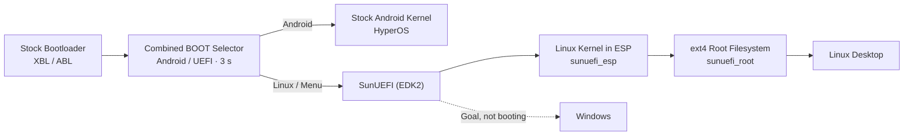

# Project SunUEFI

> [!IMPORTANT]
> **Attribution & Citation**: When referencing, porting, or building upon content from this project (code, data, images, or findings), credit the source in your documentation, description, or release page and link back to [Project SunUEFI](https://github.com/slwyts/Project-SunUEFI). When redistributing code, preserve all original copyright and license notices in each file.

> **Contributions Welcome**: If you are adding support for a new device or firmware, feel free to open a PR. See the [Contributing Guide](CONTRIBUTING.md) and [AI Collaboration Guidelines](AGENTS.md).

> **Official Community Group**: [SunUEFI Official QQ Group (Snapdragon 8 Elite)](https://qm.qq.com/q/C1RkQC2yYw)
> Group ID: **1135414849** — Recommended for following progress, getting help, and reporting issues.

EDK2 UEFI firmware and multi-OS boot support for the Snapdragon 8 Elite (SM8750) platform. On the first supported device, Xiaomi Pad 8 Pro (`piano`), the mainline Linux kernel and desktop environments are fully ported, allowing you to boot Linux through a unified UEFI while keeping stock Android intact. Linux is working today; Windows on ARM does not boot yet, and macOS / iOS UEFI boot chain support ([UniXNU](https://github.com/UniXNU/UniXNU)) is planned.
The hardware is capable, yet out of the box it is stuck running a mediocre stock Android system. We added a custom UEFI so it can boot Debian, Nyarch, or SteamOS directly from internal storage and switch back to Android at any time, preserving all Android data and stock Recovery.

## Why SunUEFI

### Product-Grade Usability

* **Graphical Boot Helper**: Manage boot options, partitions, and image installations via a WebUI on the Android side—no manual Fastboot commands or terminal steps required
* **One-Click Install & Switching**: Download the images, click install in the Boot Helper, pick your boot target, and reboot; returning to Android from Linux takes a single command
* **Out-of-the-Box Desktop**: Preconfigured animations, Chinese UI locale, default browser, and auto-login so it is ready to use on first boot
* **Stock System Preserved**: Android data, stock Recovery, and OTA update capability remain intact; **choose freely between Android and UEFI at boot with zero interference between Linux and Android**, plus bundled Simpleinit in UEFI for easy multi-OS boot management

### Innovations

* **Combined BOOT Chain**: Appends the boot selector and UEFI right after the stock kernel, bypassing Xiaomi ABL's limitation where placing a kernel in the Recovery partition skips loading `pvmfw` (causing boot integrity verification failure) while avoiding replacing the BOOT kernel (which breaks HyperOS boot), achieving seamless coexistence between Android and UEFI
* **UEFI Fastboot Service**: Runs a persistent background USB Fastboot service while UEFI is active, supporting log export, screenshots, read-only partition access, and boot requests—debuggable without screen interaction
* **Mainline Kernel Port**: Built on upstream mainline Linux; hardware support is implemented through standard kernel subsystems and Device Trees, without distro-specific hacks or scripts
* **NVRAM Variable Persistence**: Because the hardware lacks SPI Flash, UEFI NVRAM variables are stored in a standalone file on the `persist` partition without altering the partition table, minimizing invasiveness while supporting standard multi-OS boot entries and persistent UEFI variables
* **Unified Firmware Core**: One single UEFI image serves Combined BOOT, temporary boot, and the installer, eliminating multiple test image variants
* **Boot Helper Manager**: Manage and update UEFI, partitions, and OS flashing directly from Android via a KSU or SukiSU module WebUI—no extra flashing tools needed; Linux also includes a one-command boot target switcher

[Quick Start](#quick-start) · [Supported Hardware](#supported-hardware) · [Known Issues](docs/user/known-issues.md) · [Recovery](docs/user/recovery.md)

## What Happens at Boot

The stock Android kernel stays in place. SunUEFI redirects the kernel's original entry point to a small custom boot selector and appends both the selector and UEFI right after the kernel so they load together. This bundle is called Combined BOOT: choosing Android boots HyperOS, choosing UEFI boots Linux or opens the firmware menu, and stock Xiaomi Recovery continues to work as normal. The selection screen stays up for about 3 seconds—use the volume keys to switch and short-press power to confirm; with no input, it follows the saved boot route. See [Combined BOOT](docs/devel/boot/combined-boot.md) for technical details.



### Boot Route Persistence

The selection saved in the Boot Helper is the default boot route; temporarily picking another entry with the volume keys at boot does not overwrite it. After initial installation, it defaults to Android. Run `piano-next-boot android --reboot` from Linux to switch back to Android, or `reboot recovery` to enter stock Recovery without altering the saved boot route. After a HyperOS update, open the Boot Helper's **Maintenance** tab and click **Reinstall Boot**.

### UEFI Fastboot

While UEFI is running, a background USB Fastboot service stays active (device name: `SunUEFI-piano`). From a computer, you can pull logs, capture screenshots, read/write designated partitions, or trigger a boot. See [UEFI Fastboot](docs/user/fastboot.md) for commands.

| Name | When Available | Capabilities |
| --- | --- | --- |
| Stock Bootloader Fastboot | Key combo at boot, or `adb reboot bootloader` | Stock Xiaomi functionality; partition flashing |
| UEFI Fastboot (this project) | While SunUEFI is running | Logs, screenshots, reading/flashing/erasing designated partitions, boot requests |
| Linux USB Networking / SSH | After Linux boots | Standard Linux remote login and debugging |

### One Unified UEFI Core

The project maintains a single UEFI core image: `PianoUEFI-product.img`. Combined BOOT, `fastboot boot` temporary boot, and the installer all use it—there are no separate per-feature test builds. To try SunUEFI without modifying the tablet, download `SunUEFI-UEFI-Fastboot` and follow [Temporary Boot](docs/user/temporary-boot.md).

## On-Device Showcase

| | |
| --- | --- |
| <br>Boot Selection | <br>UEFI Boot Splash |
| <br>Debian / GNOME & Camera | <br>Android Boot Helper |


| Minecraft · Vulkan / Turnip | Minecraft · OpenGL / Freedreno |
| --- | --- |
|  |  |

Both photos show vanilla Minecraft 26.3 with no optimization mods running on the tablet's 3K display. The readings of roughly 446 FPS and 174 FPS are instantaneous snapshots from different scenes. The resolution discrepancy reported under Vulkan may be related to a driver bug or Wayland scaling.

### SteamOS & Gaming

| Steam Gaming Mode | Genshin Impact · In-Game |
| --- | --- |
|  |  |
| **Genshin Impact · Official Launcher** | **Magical Girl Witch Trials** |
|  |  |

## Supported Hardware

| Feature | Status | Notes |
| --- | --- | --- |
| Display | ✅ | 3200×2136, 120 Hz default, switchable refresh rate, 10-bit output |
| HDR Content | ✅ | Playback supported |
| 12-bit / FRC | ❌ | Not implemented |
| GPU | ✅ | Adreno with Vulkan (Turnip) and OpenGL (Freedreno); some GTK windows drop frames during continuous resizing |
| Touchscreen | ✅ | Tap, drag, long press, gestures (~144 Hz) |
| Official Keyboard & Touchpad | ✅ | Includes keyboard backlight; F1–F12 via Right Ctrl + number keys, see [Keyboard Guide](docs/user/keyboard.md) |
| Stylus | ✅ | Focus Pen Pro supports positioning and pressure-sensitive writing at 120 Hz, recognized natively in GNOME Tablet settings; see [Known Issues](docs/user/known-issues.md#stylus) for gestures and palm rejection scope |
| Speakers & Microphone | ✅ | Quad speakers, native mono recording |
| Wi-Fi / Bluetooth | ✅ | Bluetooth auto-configures local address using `p81` board-level NVM; normal connection range |
| Cameras | ✅ | Front and rear preview, video recording, auto-exposure, and autofocus; physical green indicator LED lights up when active |
| Flash LED | ⚠️ | Wired into standard control interface; actual illumination and capture sync not yet verified |
| Sensors & Auto-Brightness | ✅ | Auto-rotation, ambient light, proximity, compass |
| Night Light | ✅ | Uses a generic sRGB profile rather than stock factory calibration |
| Power | ✅ | Dual battery, USB PD and Xiaomi fast charging, hub charging and OTG, lid close, suspend and wake; GNOME supports Power Saver / Balanced / Performance profiles; hibernate not supported |
| USB (Linux) | ✅ | Type-C orientation and role switching, 5 Gbit/s USB networking |
| External Storage (Linux) | ✅ | USB drives, external HDDs, and card readers; FAT32 / exFAT / NTFS read/write |
| Video Encode / Decode | ✅ | Iris + V4L2 with patched FFmpeg |
| SteamOS / Proton / FEX | ✅ | Gaming Mode and Desktop Mode working; runs common Windows games (some require game-specific parameters, e.g., Genshin Impact) |
| Y700 Gen 4 UEFI Touchscreen | ✅ | NT36536 single-finger menu tap and swipe; see [Driver Notes](docs/devel/hardware/y700-touch.md) |
| Piano UEFI-Stage Touch, Keyboard, USB Host | ❌ | Navigate menus with volume and power keys |
| Fingerprint | ✅ | Standard libfprint / fprintd; enrolled, stored, and authenticated independently in Linux without using Android templates |
| IR Blaster | ❌ | Unverified |
| Windows / WinPE | ❌ | Goal, not booting yet |

Combined BOOT supports both CN and Global variants of `piano`. See [Project Status](docs/status.md) for detailed component status.

### Not Yet Implemented

* 12-bit / FRC
* Full stylus palm rejection, barrel swipe, and app shortcut gestures
* IR blaster
* UEFI-stage touchscreen, official keyboard, and USB Host
* Windows / WinPE boot

## Quick Start

### Install on the Tablet

> [!NOTE]
> Requires a Xiaomi Pad 8 Pro with an unlocked bootloader and KernelSU or SukiSU installed. Back up your data beforehand.

1. Download three packages from [Build products](https://github.com/slwyts/Project-SunUEFI/actions/workflows/build-products.yml): the Boot Helper module (`SunUEFI-Module`), the boot image (ESP, `SunUEFI-ESP`), and a system image (root, `SunUEFI-Root-<distro>`).
2. Install the module in your module manager, reboot, and tap **Open WebUI** on the module card to open the Boot Helper.
3. On the **Storage** tab, click **Create Dedicated Partition**, choose the capacity, confirm, and reboot. Skip this step if you already have a dedicated partition.
4. On the **Storage** tab, select the downloaded boot image and system image, then click **Install Selected Images**.
5. On the **Boot** tab, select **UEFI** and **Linux**, then click **Save and Reboot**.

> [!WARNING]
> First-time partitioning on a fresh tablet has not yet been verified on device; see [Known Issues](docs/user/known-issues.md#first-time-partitioning).

Available system images include Debian GNOME, Debian KDE, Nyarch GNOME, SteamOS, plus Debian and Arch Linux ARM with the Denial touch desktop. On first boot, the root filesystem automatically expands to fill the partition, so first boot takes longer than subsequent boots. Login credentials are username `piano` and password `piano123456`; auto-login is enabled by default, and the same password is used for lock screen unlock and `sudo`. See the [Installation Guide](docs/user/getting-started.md) for full instructions.

### Package Repositories

SunUEFI's kernel, Device Trees, firmware, and companion packages are updated through signed repositories—no need to reflash the system image.

| System | Repository | Update Command |
| --- | --- | --- |
| Debian GNOME, Debian KDE | APT: `https://sunuefi-repo.okassets.uk/apt` · `sid main` · `arm64` | `sudo apt update && sudo apt upgrade` |
| Nyarch | pacman: `[sunuefi]` | `sudo pacman -Syu` |
| SteamOS | pacman: `[sunuefi-steamos]` placed before `[sunuefi]` | `sudo pacman -Syu` |

Both pacman repositories share the URL `https://sunuefi-repo.okassets.uk/pacman/$repo/os/$arch`. The SteamOS-specific repo only ships override packages adapted for Valve's userspace; everything else comes from `sunuefi`. See [Package Repositories and Updates](docs/user/getting-started.md#repositories-and-updates) for manual setup.

### Build from Source

Requires an x86_64 or ARM64 Linux host with Docker. Building full system images requires an ARM64 build host and a privileged container.

```sh
./build.sh sources   # Fetch pinned upstream sources
./build.sh check     # Run host checks
./build.sh uefi      # Output artifact: artifacts/product/PianoUEFI-product.img
```

See the [Build Manual](docs/devel/building.md) for container usage, per-distro build commands, and artifact paths.

## Repository Structure

```
uefi/        EDK2 platform, product core, and boot handoff code
linux/       Kernel configs, Device Trees, BSP, desktop/distro recipes, and userspace tools
android/     Boot Helper module (WebUI) and native Android-side tools
patches/     Patches for upstream Linux, firmware, Gamescope, and related components
tools/       Build, packaging, and validation scripts (entry point: ./build.sh)
config/      Release configuration (kernel version, firmware, distros)
upstream/    Pinned upstream source submodules (never modified directly)
vendor/      Board-level input files
tests/       Host-side tests
docs/        Documentation
```

## Documentation

[User Docs](docs/user/getting-started.md) · [Developer Docs](docs/README.md) · [Project Status](docs/status.md) · [Third-Party Sources](THIRD_PARTY.md) · [License](LICENSE.md) · [Contributing Guide](CONTRIBUTING.md) · [AI Collaboration Guidelines](AGENTS.md)

## Standing on the Shoulders of Giants

Upstream sources are pinned under `upstream/`, while our modifications live in `patches/`, `uefi/`, `linux/`, and the build tooling. The UEFI stack builds on [EDK2](https://github.com/tianocore/edk2) and [Mu-Silicium](https://github.com/Project-Silicium/Mu-Silicium), with the boot menu from [simple-init](https://github.com/BigfootACA/simple-init). The kernel started from [linux-piano](https://github.com/blu-sharky/linux-piano), the Debian rootfs from [debian-piano](https://github.com/blu-sharky/debian-piano), device firmware is extracted from official OTAs and organized by component under `vendor/firmware`, and graphics userspace uses [Mesa](https://mesa3d.org/). See [Upstream Projects](docs/devel/upstreams.md) for the complete list and each project's role.
